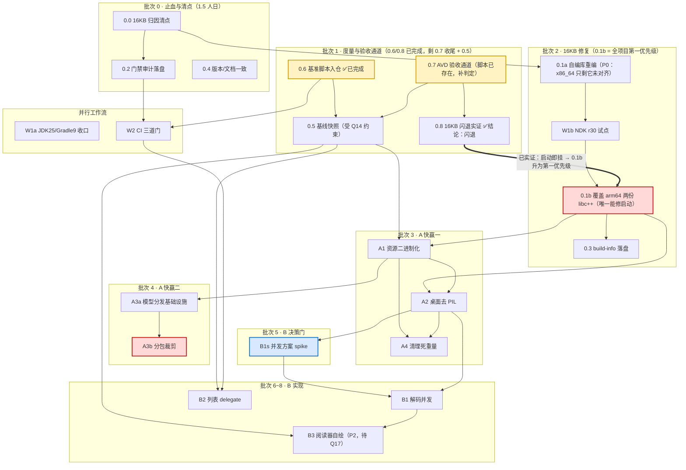

# JMComic-qt 实施任务分解与依赖排序

> 版本：2026-11-09（对应方案 `docs/qt_cpp_migration_plan.md`）  
> 编制：架构师 高见远  
> 范围：阶段 0 + 阶段 A + 阶段 B 的可执行任务清单；阶段 C（C++ 迁移）不在范围内，仅保证不破坏其前置条件。  
> 本文档**只做设计、分解、排序与风险判断**，不含代码实现。

---

## 0. 结论摘要（先看这一节）

> ⚠ **本节写于 2026-11-09 上午；当天下午工程师交付了实测结果，见 §0A。§0A 推翻了本节第 1 条的顺序建议（16KB 已实测"启动即挂"，不再是"先度量再修复"），其余各条仍然成立。**

1. **方案的整体决策成立**（先取确定收益、迁 C++ 推迟到 C0 决策门），但**执行顺序必须调整两处**：
   - ~~把"度量能力建设"（新增 0.6 / 0.7 / 0.8）提到 0.1 之前。~~ **【已被 §0A 推翻】** 原理由是方案 §1.4 的验收口径全靠三个未入仓脚本；现在脚本已入仓（0.6 ✅）、实证也已出（0.8 ✅ 结论=闪退），所以正确顺序是：**0.1b 立即开工（后台长时间构建），0.5/0.7 与之并行**。
   - 把 0.3（build-info 落盘）**并入 0.1b 的同一次构建**，省掉一轮 4 小时机器时间。（仍成立）
2. **0.1 必须拆成 0.1a / 0.1b**。15 个未对齐库里，本项目 CMake 自编的只有 `libsr_qnn.so` / `libsr_qnn_proc.so`（`android/build_android.sh:482-501`，本机 NDK 30.0.16248370 已装，重编只需分钟级）；`libpython3.14` / `libc++_shared` / openssl 等来自 **p4a dist 与 p4a 内置 recipe**，必须走全量 dist 重建（40~60 min/ABI，且 `android/recipes/` 里只有 `curl_cffi` 和 `jmcomic`，其余配方不在本仓库）。两者风险等级差一个数量级，不能算一个任务。
3. **A1 的实际影响面是方案描述的三倍以上**（详见 §2.1）：`import images_rc` 出现在 **6 个文件**（`src/start.py` + 5 个由 `pyside6-uic` 生成的 `src/interface/ui_*.py`，因为 `ui/*.ui` 里有 5 处 `<include location="../res/images.qrc"/>`）。只改 `start.py` 会在下次跑 `script/build_ui.py` 时被自动重新引入。且 **Android 侧有个方案完全没提的硬阻塞**：p4a 只拷贝 `source.include_exts` 放行的扩展名（现为 `py,png,jpg,...` + `onnx,txt,qsb`），**`.rcc` 不在白名单**——不加进去，Android 上图标会全部静默消失（不崩、不报错）。
4. **A2 的改动比方案小得多**（详见 §2.2）：`src/task/task_qimage.py` 里**已经有** `_SegmentQImage()` + `ConverQImage(info, q)` 的 QImage 直通路径，只是被 `if platform_mobile.IsAndroid():` 挡着。所谓"桌面去 PIL"= 放开这个条件 + 保留 bytes 回退。方案担心的 bytes/QImage 契约问题**只影响 `TaskMulti` 进程池 worker 和 `mobile_ui_diag` 的三处诊断打印，而这两处根本不需要改**——收益全部在单线程看图路径上。
5. **W1 有一部分已经在仓库里了**：`android/tools/versions.env` 已经把基线写成 `JM_JDK_MAX:=25` / `JM_GRADLE_MIN:=9.1.0`，注释写明"基线（0.88 起）：JDK 25 LTS + Gradle 9.x"。而 `resolve_jdk.sh` 头注释仍写"默认 17~24"。所以 0.4 不只是"改注释好看"——它是唯一能让后来者知道版本区间已变的地方，属**必须做**。
6. **W2 也部分已存在**：`.github/workflows/android.yml` 已经在 push/PR 到 main 时跑宿主侧回归（5 道门 + shell 语法 + 全量字节码编译）。W2 剩余的是"页对齐干跑 + 体积预算 + 夜间 x86_64"，不是从零搭 CI。**但发现一个隐患**：`android.yml` 注释与实现用的是 **Python 3.11 + PySide6 6.11.2**，而 APK 实际链路已到 **CPython 3.14 + Qt 6.12**——"CI 与 APK 同一套环境"的假设已经失效，这一条需要用户拍板（见 Q7）。
7. **B 阶段的最大不确定性是 B1**。进程池 vs pybind11 的 2 天 spike 必须真的做，不能"边做边看"——因为 pybind11 分支会引入新的原生构建物，**ABI / NEON / 16KB 对齐三条门禁都要重新过一遍**，代价远超一个解码函数。

---

## 0A. 实测更新（2026-11-09，来自工程师的 bench 与 AVD 验证）

> 本节晚于 §0 正文写入，分两轮：**更新 1~4**（第一轮：bench 与 AVD 实证）推翻了 §0 的顺序建议；**更新 5~8**（第二轮：口径校准与 dist 实况）改写了 A2 的验收方式、动摇了 B3 的价值基础、并把 0.1b 的工作量下调。**读后面的任务表之前必须先读本节。**

### 更新 1：0.8 已出结论 —— **16KB 不是"退回兼容模式"，是装完启动即挂**

在 16KB 页镜像（`PAGE_SIZE=16384`）上装 0.87 x86_64 包，实测链路：

```
dlopen failed: libc++_shared.so program alignment (4096)
                cannot be smaller than system page size (16384)
        → QtLoader: UnsatisfiedLinkError
        → 进程未存活（avd_verify.sh 判定 FAIL，4 项）
```

**三个直接后果**：

1. **Q4 已有答案**：不需要再"先实测再决定"，16KB 是**一票否决级**缺陷。方案把 0.1 放最前的判断是对的，我原文档里"先度量再修复"的建议**应作废**（那条建议的前提"若实测能跑则降优先级"已被否证）。
2. **修复点被精确定位到 `libc++_shared.so`** —— 这是 **class-2（p4a dist 产物）**，不是本项目 CMake 自编的。也就是说：**0.1a（重编 `libsr_qnn*`）完全不解决启动闪退，只有 0.1b 能修好**。原文档把 0.1a 排在 0.1b 前面只因为"它快"；现在必须明确：0.1a 只解决超分可用性，0.1b 才是"用户装得上、打得开"的唯一路径，**0.1b 是全项目第一优先级**。
3. **设备侧基线（0.5）出现一个此前没预见到的问题**：0.87 在 16KB AVD 上根本起不来 → **无法在现有 AVD 上测到"修之前"的 PSS / 首帧**。见新增 Q14。

### 更新 2：0.6 已由工程师完成（我原列为"待做 2 人日"，现改为"已交付，剩口径校准"）

已入仓：`script/bench_startup.py` / `bench_pipeline.py` / `bench_reader.py` / `bench_common.py`，统一 CLI（`--runs` / `--json` / `--out` / `--src` / `--python`），口径写在各自 `--help`。首帧判定复用 `src/start.py` 的 `Run(afterShow=...)` 扩展点，**没有改业务代码**（这一点很重要：0.5 的基线因此不会因为"为了测量而改了被测对象"而失真）。

但实测数值与方案基线**不可直接比对**，原因是口径与环境双重差异：

| 指标          | 工程师实测（WSL/offscreen，机器在跑构建）              | 方案基线    | 可比的障碍                                                                             |
| ----------- | ---------------------------------------- | ------- | --------------------------------------------------------------------------------- |
| 冷启到首帧       | 7254.9 ms（墙钟 7408.2，n=3，单次抖动 6.5~11.4 s） | 998 ms  | WSL 从 `/mnt/c`（9p）导入整个应用（含 22MB `images_rc.py`）+ offscreen 软件渲染 + 机器在构建           |
| 首帧 RSS      | 267.9 MB                                 | 138 MB  | 同上（offscreen 与 9p 都会放大）                                                           |
| 单页 解码+缩放+显示 | 18.01 ms（解码 15.00 + 缩放 1.09 + 动图判定 0.03） | 39.6 ms | **口径不同：工程师的管线不含"PIL 解码→重编码→Qt 再解码"那一段，而 39.6ms 很可能包含它**                           |
| 60 页建场      | 5.07 ms（+events 7.48）                    | 154 ms  | 工程师口径**不含解码**；方案的 154ms 是否含 `InitAllQLabel` 创建 + proxy 构建需澄清（B3 的验收阈值 60ms 直接受影响） |

**因此新增两条硬性要求**：

- **0.5 基线必须在"方案口径的原生环境"（Windows 桌面原生，非 WSL/非 offscreen）上取**，并在文档里显式记录环境指纹（OS / Python / PySide6 / 是否 offscreen / 代码来源是 9p 还是本地盘 / 机器是否空闲）。WSL/offscreen 的数值只能作**相对变化**的参考，不能当绝对值基线。
- **A2 的验收阈值（≤26ms）当前不可用**，因为现有 bench 口径本来就不含 PIL 重编码 —— 拿不含 PIL 的口径去验"去掉 PIL 后的收益"，结果会是"看起来没变化"。**A2 验收前必须先加 `--legacy-pil` 对照分支**（见 Q15）。

### 更新 3：PySide6 6.12.0 + Python 3.11 的 finalize GC 崩溃（实测 A/B 已确认）

现象：Python 侧创建过大量 `QColor`/`QRect` 临时对象后，解释器 finalize 阶段直接  
`Fatal Python error: none_dealloc: deallocating None: bug likely caused by a refcount error in a C extension`  
（6.11.2 同一段代码不崩）。

**影响三处验收判据，必须写进所有脚本与 CI**：

1. **W2 / CI**：用 6.12 跑 offscreen 回归时，**进程退出码可能是 134 而不是 0**。CI 断言必须区分"退出码非 0 但产物齐全（已知 GC 崩溃）"与真失败，否则会造出一批"假红"，最后大家学会忽略 CI —— 比没有 CI 更糟。这也**实证了原文档 D6/Q7 的判断**：CI 停在 6.11.2、APK 已到 6.12，这个版本错配不是纸面问题，它正在造成"CI 绿但 APK 红 / CI 红但代码没错"。
2. **0.7 / `avd_verify.sh`**：PASS/FAIL 判定不能只看进程退出码，必须"退出码 + 产物（截图/日志/PSS）+ logcat 关键字"三者合判。
3. **`host_test_*.py` 系列**：31 个宿主测试若都用 6.12 跑，需要统一加"已知崩溃白名单"，否则 W2 的门禁全部不可用。

### 更新 4：0.7 的 `android/tools/avd_verify.sh` 已存在并被实际使用

原文档把 0.7 当成"新建脚本（2 人日）"，实际该脚本已存在且已在 16KB 模拟器上跑出 FAIL(4 项)。**0.7 降级为"补齐判定规则与回归用例文档"，工作量 2 → 0.5 人日**；省下的时间建议转给 Q11 的视觉回归基线。

### 更新 5（2026-11-09 晚，第二轮实测）：**A2 的收益已被证实，但验收方式必须改**

`bench_pipeline.py` 新增 `--legacy-pil`（复刻 `SegmentationPicture()` 的 PIL 链路：PIL 解码 → 10 块逆序还原 → 重编回 JPEG → 再交 Qt 解码缩放）与 `--both`（同机同样本对照）。同一次运行、`--runs 3 --iters 10`：

| 路径                   | p50          | p95   |
| -------------------- | ------------ | ----- |
| Qt 直通（现状 Android 路径） | **18.77 ms** | 18.95 |
| legacy-pil（桌面现状路径）   | **37.31 ms** | 37.95 |
| 差值 = A2 的收益上限        | **18.54 ms** | —     |

**37.31 ms 与方案基线 39.6 ms 基本吻合 → 方案的 39.6ms 确认为 legacy 口径。A2 的收益从"待验证"变成"已量化"。**

但有三条**必须写进实现与验收**的细节：

1. **legacy 的 PIL 段必须计入计时区**。工程师踩过这个坑：一开始只把"重编码后的字节"喂给 Qt，结果 legacy **反而快 1.5 ms** —— 因为 PAL 重编后字节从 928 KB 降到 618 KB，Qt 解码更省。**若照那样测，会得出"A2 去掉 PIL 没有收益甚至负收益"的假结论。**
2. **A2 验收必须用 `--both`，不能用单一路径的绝对值**。原因见下条。
3. **18.54 ms 是 CPU 总成本差，不等于用户感知的首图延迟差**。因为生产中 PIL 在 `TaskMulti` 子进程里**并行**跑，而 Qt 直通在主线程跑。这条对 B1 有直接含义（见更新 7）。

**因此 A2 的验收标准要改写**：从"单页 ≤26 ms"改为"**`--both` 对照下，Qt 直通路径相对 legacy 路径 p50 下降 ≥30%（实测已达 49.7%：37.31→18.77）**，且像素级零差异"。原"≤26ms"作为参考值保留，但不再是判定依据——因为 18.77 已远低于它，用绝对阈值判定等于没判定。

### 更新 6（2026-11-09 晚）：**B3 的收益基准被实测动摇，需要重新界定范围**

`bench_reader.py` 新增 `--mode`，四种口径同机实测（n=3）：

| mode                       | 复刻内容                                                                                                                                 | p50           |
| -------------------------- | ------------------------------------------------------------------------------------------------------------------------------------ | ------------- |
| `build`（工程师第一次误报的口径）       | new `ReadQGraphicsProxyWidget` + setPixmap + addItem + setPos，**没有 SetLabel**                                                        | 4.2 ms        |
| `initall`（**线上建场口径**，现为默认） | `QtReadImgPoolManager.GetProxyItem()` + `SetLabel`（每页 `QFont().setPointSize(64)` + setText）+ addItem + resize/setMin/setMax + setPos | **10.0 ms**   |
| `initall-pixmap`           | 上述 + 每页 setPixmap(已解码)                                                                                                               | 7.3 ms        |
| `initall-decode`           | 上述 + 每页 `QPixmap.loadFromData` 再贴                                                                                                    | **1186.6 ms** |

**两个结论，第二个是坏消息**：

1. **方案的 154 ms 无法用任何单一 mode 复现**。最可能的解释是"建场 + 首屏 6~~8 页解码"（按 19 ms/页，68 页 ≈ 114~~152 ms，与 154 吻合）。**B3 的"开章 ≤60 ms"阈值必须注明 mode，建议用 `initall`（建场口径，不含解码），解码单列在 `bench_pipeline`。**
2. **建场只占 10 ms，而 B3（阅读器去 proxy）优化掉的正是建场** —— 也就是说：**B3 的收益上限约 10 ms，而它的验收目标"≤60 ms"在建场口径下早已达成（10 ms），在含解码口径下永远达不成（1187 ms）。** 这直接动摇了 B3 的存在理由。

**B3 的价值必须从"时间"重新定位到"内存"**：方案原文另有一条"+8 MB / 60 页"，那是 `QGraphicsProxyWidget` + `QLabel` 的真实成本，这条仍然成立（60 个 QWidget 的固定开销不会因为建场快就消失）。**因此提请拍板（Q17）：B3 是按"降内存"重新立项，还是整体后延/砍掉。** 在用户决定前，B3 保持 15 人日估算但**不应排进关键路径**。

### 更新 7（2026-11-09 晚）：**0.1b 的工作量与风险大幅下调，可能已接近完成**

工程师在正在跑的那次构建里查了 dist 实际对齐状态：

- **x86_64**：`194 对齐 / 1 未对齐 / 1 跳过`，唯一未对齐的是**我们自己的 `libsr_qnn_proc.so`（p_align=4096）**；`QtCore/QtGui/QtWidgets/QtSvg/QtSql/QtNetwork` 等**全部 16384**。
- **arm64**：`libc++_shared.so` 与 `libc++_shared-d523468d.so` **是同一份库的两个名字**（同尺寸 1330832、md5 均 `4c038ab17e9e4c24c3e35daa13f1f7ac`；后者来自 `curl_cffi` wheel 的 `curl_cffi.libs/`，由 `android/recipes/curl_cffi` 复制）。0.87 arm64 的对齐报告里**这两个名字都在未对齐名单**。

**这意味着**：

1. **NDK 30 重编后 Qt/p4a 侧已经合规** —— 我原文档最担心的"p4a 官方只保证 ≤28c、可能编不过"风险**没有发生**。0.1b 的工作量从"p4a dist 全量重建（2 人日 + 高风险）"收窄为"**0.1a（重编 `libsr_qnn*`）+ 覆盖 arm64 那两个 libc++ 名字**"，估**1 人日 + 中风险**。
2. **0.1a 的定位反转**：它不再是"只影响超分"，而**可能就是启动修复的最后一块**（x86_64 侧只剩 `libsr_qnn_proc.so`）。优先级从 P1 **回调为 P0**。
3. **但有一处必须警惕（待确认）**：上面是 **dist 目录**里的对齐状态，**不等于 APK 里的对齐状态**——APK 里还有从 wheel 拷贝进来的库。必须出包后用 `check_elf_page_align.py` 对**APK**复验一次，才能宣布 0.1b 完成。**这是 0.1b 唯一的待确认项。**
4. arm64 侧要处理的是"**同名的第二份旧副本**"，不是"Qt 编错了"。修法二选一：覆盖两份同名文件，或让 `android/recipes/curl_cffi` 不再复制旧的那份（推荐后者，从根上少一份 1.3 MB）。

### 更新 8（2026-11-09 晚）：Android 17（SDK 37）能安装 targetSdk=34 的包——原"待确认"可关闭

证据（`emulator-5554` 实跑）：镜像 `google/sdk_gphone16k_x86_64/emu64xa16k:17/CP41.260831.015/...`，`ro.build.version.sdk=37`，**`getconf PAGE_SIZE=16384`**（即 `Pixel_9a` 确为 16KB AVD，16KB 验证不需要真机）；`adb install -r` → `Success`；`dumpsys package` → `versionName=0.87 minSdk=34 targetSdk=34 primaryCpuAbi=x86_64`。

**→ 安装不受限，0.87 死在后面的 `dlopen`。** 我原文档里"`Pixel_9a` 装 targetSdk=34 包的行为待确认"这一条可以关闭（差异表 D10、0.7 卡片的风险项均已同步）。

**同时修复了一个会伪造绿光的判定缺陷**：`avd_verify.sh` 把"应用被标记为 16KB 兼容模式"从 `check_16kb_device.sh` 的 WARN **提升为 FAIL**。原逻辑下会出现"设备是 16KB → 全部检查项绿 → 但应用其实在兼容模式跑"的假结论。

### 更新 9（2026-11-09 第三轮）：**主线程占用的担心被实测否定，A2 可以放心做**

我在第二轮曾担心"A2 之后主线程每页独占 18.77ms、10 页就是 188ms 全串行，首屏反而更慢"，并要求工程师加测主线程占用。**实测结果与我的假设相反，这条担心应当撤回。**

`bench_pipeline.py --main-thread` 实测（每页，n=3×10 页；legacy 分支**真的** spawn `multiprocessing` 进程跑 PIL，不是模拟并行）：

| 路径                  | 主线程阻塞        | **主线程 CPU**  | 子进程 CPU      | 合计 CPU   |
| ------------------- | ------------ | ------------ | ------------ | -------- |
| `legacy-pil`（A2 之前） | **39.93 ms** | **14.52 ms** | **22.94 ms** | 37.46 ms |
| `qt`（A2 之后）         | **17.08 ms** | **16.08 ms** | —            | 16.08 ms |

- 主线程 CPU：14.52 → 16.08，**只 +1.6 ms/页（+11%）**，不是我推测的 +17.8 ms；
- 主线程阻塞：39.93 → 17.08，**−22.8 ms/页（−57%）**；
- 总 CPU：37.46 → 16.08，**−21.4 ms/页**；
- 10 页预加载估算：阻塞 **399 → 171 ms**；主线程 CPU 145 → 161 ms。

**原因（这个机制值得记住）**：legacy 的主线程**本来也要解码一次** —— 只不过解的是 PIL 重编码后的小图（618 KB，14.5 ms），而 A2 之后解原始图（928 KB，16.1 ms）。**真正贵的那趟 928 KB PIL 解码一直待在 worker 里。** 所以 A2 省的是"子进程那 23 ms"，主线程只多扛 1.6 ms。

**因此 A2 的验收判据再改一次（第三次，也是最终版）** —— 两条都可在 CI 自动判定：

1. **主线程 CPU 增幅 ≤ +3 ms/页**（实测 +1.6）；
2. **主线程阻塞下降 ≥ 40%**（实测 −57%）。

同时**修正文档里的表述**：凡出现"CPU 总成本降 18.54 ms"的地方，应读作"**总 CPU 37.5→16.1 ms/页；主线程 CPU +1.6 ms/页；主线程阻塞 −22.8 ms/页**"。原文那种单数字写法容易被误读成"主线程也省了 18ms"。


**对 B1s 的影响**：这条实测**降低**了 B1 的紧迫性 —— 现状下主线程阻塞已经被 A2 砍掉 57%，"主线程被解码占满"这个假设不成立。B1s 仍然要做（子进程 CPU 23ms 完全可以被并行化），但**它不再是一个"可能推翻 A2"的决策门，而是一个纯增益评估**。B1 的优先级可从 P1 微调为 P1（不变），但**预期收益应下调**：从"10 页 200→80ms"改为"在 A2 之后的 171ms 阻塞上再压缩"。

### 更新 10（2026-11-09 第三轮）：**0.1a 已完成**

`android/sr_qnn/cpp/CMakeLists.txt` 用 `foreach` 覆盖两个 target，两个 ABI 重编后 **PT_LOAD 全部 `0x4000`**。→ **0.1a 的实际状态是"已完成"**，0.1b 的 x86_64 侧预期为 `194 对齐 / 0 未对齐 / 1 跳过`。

**这条把 0.1 这一大项彻底收口了**：原方案把它当作"用 NDK ≥ r28 重编 4 个库 + 7 个 recipe 产物"（隐含要全量重建 dist），实测下来实际是：

- `libsr_qnn*`：本项目 CMake，`foreach` 改一行 + 10 分钟重编（**0.1a，已完成**）；
- `libc++_shared`：dist 里 Qt/p4a 侧已被 NDK 30 编成 16384，arm64 侧只剩一份同 md5 的重复副本要处理（**0.1b**）；
- 其余 recipe：**本来就合规，无需处理**。

**待确认的唯一一项**：APK 级复验（`check_elf_page_align.py <apk>`）。**dist 与 .so 的 PT_LOAD 已确认，但 APK 里还有从 wheel 拷入的库**——这条硬规则不变。

### 更新 11（2026-11-09 第三轮）：环境指纹必须加 `loadavg`，否则 21% 的差异会被误读成"变快了"

实测：**同机空闲时 `bench_startup` p50 = 5680 ms；后台有构建在跑时 = 7254 ms（差 21%）**。

工程师已把 `loadavg` 写进三个 bench 脚本的 JSON `env` 字段（同时加了 `compare_scope: "offscreen-relative-only"`）。**修订 14 的"环境指纹"从三件套升级为四件套**：① 口径定义 ② 环境指纹（OS/Python/PySide6/是否 offscreen/代码盘是否 9p/**loadavg**）③ 样本来源与数量 ④ 采集时刻是否与构建并发。

**这条的现实意义**：如果没有 loadavg，一个在空闲机上测的 5680 ms 会被当成"代码优化带来的 21% 提升"。**这是最容易被误判为成果的一类假数据**，比"测错了口径"更隐蔽。

### ⚠ 紧急风险（2026-11-09 第三轮发现）：全队产物目前都是**未跟踪文件**，一次 `git clean -df` 全部消失

跑 `git status` 后实测，以下 **12 项未被 git 跟踪**，且**都不在 `.gitignore` 里** → `git clean -df`（不带 `-x`）会直接删掉：

```
.Trash-0/
android/tools/avd_cases.md            ← AVD 验收用例
android/tools/avd_verify.sh           ← AVD 验收通道本体
android/tools/gen_build_info.py       ← 0.3 的实现
android/tools/record_unaligned_override.py  ← 0.2 的实现
docs/bench_raw/                       ← 基准包留档
docs/implementation_task_list.md      ← 本文档
docs/qt_cpp_migration_plan.md         ← 【用户已确认的迁移方案】
script/bench_common.py                ← bench 公共层
script/bench_pipeline.py              ← bench 管线
script/bench_reader.py                ← bench 阅读器
script/bench_startup.py               ← bench 启动
src/config/build_info.py              ← 0.3 的读取端
```

**这不是"以后要注意"，是"现在就有风险"**：一次误操作 `git clean -df`（IDE 的 "Clean untracked files" 就有这个行为）会同时抹掉基准脚本、AVD 验证通道、本文档以及**用户已确认的迁移方案**。

**处置建议（按优先级）**：

1. **立即 `git add` 上述代码/文档类产物（不含 APK）并提交** —— 12 项里除 `.Trash-0/` 与 `docs/bench_raw/` 外全部应当入库；
2. `docs/bench_raw/**/*.apk` 已在 `.gitignore`（第 183 行），但**只入库 `README.md`（sha256 表）**；
3. APK 本体已由工程师移到**仓库外** `C:\Users\WQ159\jm-baseline\0.87\`（git 完全碰不到），这是正确的处置；
4. `.Trash-0/` 建议直接删除或加进 `.gitignore`。

> **注**：工程师在第三轮曾提出"加进 `.gitignore` 会让 `git clean -df` 也能删掉它"，**这个 git 语义恰好相反**。我做了实测（`git init` 临时仓库，一个被忽略的 apk + 一个未忽略的 apk）：
>
> ```
> $ git clean -nd     → Would remove d/plain.apk          # 未忽略的被删
>                       （不含 d/ignored.apk）            # 被忽略的未被列出 → 受保护
> $ git clean -nxd    → Would remove d/                   # 带 -x 才连忽略文件一起删
> ```
>
> 即：**未被忽略 = `-df` 会删；已忽略 = `-df` 不删、`-xdf` 会删。** 所以"加 ignore"确实提供了一层保护（挡住 `-df`），只是挡不住 `-xdf`。**"移到仓库外"是更强的方案，应当采纳；但理由要说对**，否则下次评估同类风险时会得出相反结论。
>
> 当前 12 项之所以危险，恰恰是因为它们**既未跟踪、又未被忽略** —— 这是最脆弱的状态。

#### 处置进展（2026-11-09 晚，已验证）

| 项                       | 状态                                                                           |
| ----------------------- | ---------------------------------------------------------------------------- |
| 12 项产物                  | **已 `git add`（`git status` 显示 12 个 `A`），未提交**                                |
| 暂存区是否混入 APK             | **0**（`git diff --cached --name-only \| grep -c '\.apk$'` → 0，符合"大二进制不入库"纪律） |
| 现仍会被 `git clean -df` 删的 | 仅剩 `.Trash-0/`（57 KB 无主垃圾，非本项目产物）                                            |
| APK 本体                  | 已移出仓库至 `C:\Users\WQ159\jm-baseline\0.87\`，git 完全碰不到                          |

#### ✅ 已闭环（2026-11-09 晚，commit 后验证）

**team-lead 已提交，风险解除。** 三个 commit 覆盖全部产物：

```
68d65a0  docs: 迁移方案与实施任务清单入档，并清理过期版本说法
c7179ec  test(bench): 桌面基准三件套 + AVD/真机一键验收
aaeba20  fix(android): sr_qnn_proc 也按 16KB 页对齐链接
```

验证结果：`git status --short` 只剩 `?? .Trash-0/`；`git clean -nd` 只剩 `.Trash-0/`；`git ls-files` 确认 `avd_verify.sh` / `docs/build_audit/README.md` / `script/bench_pipeline.py` / `docs/qt_cpp_migration_plan.md` 均已入库。

**仍建议处理 `.Trash-0/`**（57 KB，删除或加 ignore 均可），它是现在唯一还会让 `git status` 出现噪音的东西。

> **本节的价值不在于"发现了一次风险"，而在于它暴露了一个过程缺陷**：项目节奏是"每阶段暂停"，而暂停期间**产物还全是未跟踪文件**。这次是 12 项，下一次可能是 30 项。修订 19 已经把"每批次暂停点 `git add` 并提交"固化为交付动作，这条应当保留在文档里长期生效，不能因为这次修好了就删掉。

**⚠ 仍有两个未闭合的窗口，本批次必须处理完：**

1. **"暂存"不等于"安全"**：只要有人 `git reset`，这 12 项立刻退回未跟踪状态，重新变成 `git clean -df` 的猎物。**必须提交（`git commit`）才算交付。** 这也是修订 19 要求"`git add` **并**提交"的原因——`git add` 是能挡住 IDE "Clean untracked files" 的**最小**动作，但不是终点。
2. **`docs/build_audit/` 目录尚不存在**：0.2 的实现（`android/tools/record_unaligned_override.py`）设计为双写——`build_logs/unaligned_override.json`（就地可见但被 gitignore）+ **`docs/build_audit/unaligned_overrides.jsonl`（仓库内可追溯的审计主档）**。但该目录**至今未被创建**，会等到第一次放行时才由脚本临场建出来——那一刻它就是个未跟踪目录，同样暴露在 `git clean -df` 下。**建议现在就创建 `docs/build_audit/README.md`（说明用途与格式）并一起提交**，让审计主档从第一天起就在版本库里。否则"可审计"这件事建立在一个可能被误删的目录上。

> **`.Trash-0/`**：57 KB，建议直接删除；若不想删，加进 `.gitignore`（按正确语义可挡 `-df`）。

### 更新 12（2026-11-09 晚）：阶段 0 的 0.2 / 0.3 / 0.4 已全部完成

按任务系统状态，阶段 0 的代码类任务已交付并过独立验收（QA 已验 6 项改动）：

| 任务                 | 交付物                                                                                                             | 与我原设计的差异                                                                                                                                                                                                                |
| ------------------ | --------------------------------------------------------------------------------------------------------------- | ----------------------------------------------------------------------------------------------------------------------------------------------------------------------------------------------------------------------- |
| **0.2 门禁审计落盘**     | 新增 `android/tools/record_unaligned_override.py`                                                                 | **采纳了修订 11 的双写方案**：`build_logs/`（就地）+ `docs/build_audit/unaligned_overrides.jsonl`（仓库内追加主档），并在文件头注释里写明"`build_logs` 被 gitignore、清缓存就没了"这个理由。→ **"可审计"从"只存在于本地"变成真的可追溯。** 唯一缺口：`docs/build_audit/` 目录尚未创建（见上）。           |
| **0.3 build-info** | `android/tools/gen_build_info.py` + `src/config/build_info.py`（读取端）+ 设置-关于页展示 + `build_android.sh` 打包前调用        | **回答了 Q8**：走 `android.add_assets` 但**仅含 json**（不是模型那种 45MB 副本），读取端优先 `assets:/build-info.json`（Qt 的 `QFile` scheme），桌面回退读 `android/build_logs/build-info.json`。**这个双路径设计比我在 Q8 里给的二选一更好**——它同时覆盖了"APK 内可反查"与"桌面开发环境可读"。 |
| **0.4 版本/文档一致**    | `resolve_jdk.sh` 头注释、`src/requirements_android_ci.txt`、`android/README.md`、`android/tools/README.md`、`SKILL.md` | 与我设计的范围一致（含"两处 requirements 文件"那条）。                                                                                                                                                                                     |

**另有一项方案与我原文档都未覆盖、但已完成的工作**：

- **`android/tools/local.env` 改为 WSL Ubuntu 可用路径**，并注明"本机配置性质、不 git add"。→ 已补进任务清单。
  - **补充核实**：该文件**早已被 `.gitignore:178` 忽略**（模板 `local.env.example` 入库），机制一直存在；缺的只是 `android/tools/README.md` 里的文档说明（原本 0 命中），现已补齐。**我最初判断"没有机制防护"是错的，已在修订 20 里订正并记下教训。**

### 更新 13（2026-11-09 深夜）：**"0.1 已收口"这个结论是错的，必须撤回**

> 我在更新 10 里写了"0.1 这一大项至此收口"。**这句话是错的，本节撤回它。** 错在两处：① 门禁脚本的扫描范围有盲区，我看到"194 对齐 / 1 未对齐"就以为覆盖了全部；② 我把 0.1a 当成"顺带在构建里完成"，但构建脚本根本不编译它。

#### 错误 1：`check_elf_page_align.py` 的扫描范围有盲区——它看不见 Python 扩展模块

实测（源码 `android/tools/check_elf_page_align.py:26` 与 `:243-248`）：

- APK 分支只枚举 `i.filename.endswith(".so")`，并交给 `LoadElfZip` 解析；
- `libpybundle.so` **名字虽是 .so，内容是打包容器的数据文件** → `LoadElfZip` 返回 `meta is None` → 归入 `skipped["notelf"]`，**跳过**；
- 而 **Python 侧扩展模块（含 `shiboken6`）全部在 `libpybundle.so` 内部的 `_python_bundle/` 里**，运行时才解包到 `files/app/_python_bundle/`。

**所以"`lib/` 侧 194 对齐 / 1 未对齐"只覆盖了原生库，完全不覆盖 492 个 Python 扩展 .so。** 这是门禁自身的盲区，不是执行疏漏。

#### 错误 2：0.1a 不是"顺带完成"，而是一个必须显式执行的步骤

实测 `android/tools/wsl_build_apk.sh:93-99`：

```
# libsr_qnn.so 要编译，只提示不自动跑（它要 1 分钟且会再同步一次仓库）。
if [ ! -f "$ANDROID/libs/$JM_ABI/libsr_qnn.so" ]; then
    echo "[warn] ... 先跑：JM_ABI=$JM_ABI bash android/tools/wsl_build_native.sh"
fi
```

→ **打 APK 的脚本只 warn，不编译**。真正编译的是 `android/tools/wsl_build_native.sh:65-76`（`cmake` + 拷贝 `libsr_qnn.so` 与 `libsr_qnn_proc.so`），本轮由 team-lead 显式跑过。  
**因此 0.1a 的准确定义是：`JM_ABI=<abi> bash android/tools/wsl_build_native.sh` 必须显式执行，且在每个 ABI 上各跑一次。** 我原文档把它写成"落在某次构建里"，会让下一个人以为"打个包就自动对齐了"——这是会实际导致漏修的表述错误。

#### 结论修正：16KB 的真实现状

team-lead 用独立扫描器逐个解析 bundle 内程序头（本机无 `libpybundle.so`，我无法复验，此处引用其实测数据）：

| 范围                 | 未对齐数                                                 | 能否在本仓库修复                                   |
| ------------------ | ---------------------------------------------------- | ------------------------------------------ |
| `lib/<abi>/`       | 14 → **1**（`libsr_qnn_proc.so`，CMake 已修，待重打包）        | ✅ 能                                        |
| bundle 内 492 个 ELF | **1**：`shiboken6/Shiboken.abi3.so`（`p_align=0x1000`） | ❌ **不能** —— PySide6 官方 wheel 产物，p4a 只是原样拷入 |

**因此：包仍会被系统标记为 16KB 兼容模式，Android 17 上仍起不来。0.1 未完成。**  
用户已决定"先查新版 PySide6 wheel 的 shiboken 是否已对齐"，工程师正在查。**这是 0.1 目前唯一的、且可能不受本项目控制的阻塞点。**

#### 因此新增任务 0.1c，并改写 0.1 的验收口径为**两条门禁**

见 §3 的 0.1c 卡片。核心变化：**"16KB 合规"必须同时满足 `lib/` 页对齐 和 bundle 内 .so 页对齐，缺一不算过。** 原文档只有前一条，等于给了一个会让假绿通过的门槛。

### 更新 14（2026-11-09 深夜）：三张任务卡的"已完成"需要打折

| 任务          | 我原写         | 实际                                                                                                 |
| ----------- | ----------- | -------------------------------------------------------------------------------------------------- |
| **0.1a**    | 已完成 ✅       | **代码已改、编译需显式执行**（`wsl_build_native.sh`）。若某 ABI 未跑，该 ABI 的 `libsr_qnn*` 仍是 4096。**改为"待按 ABI 逐个确认"** |
| **0.1b**    | 1 人日 + 2~4h | **不能完成** —— 它只能修 `lib/` 侧；bundle 侧的 shiboken 卡在 wheel，超出本仓库范围。**0.1b 与 0.1c 的边界必须切开**              |
| **0.1（整项）** | 已收口         | **未完成**，且阻塞点可能不在本项目控制内                                                                             |

**这条的教训（已升为修订 22）**：**门禁脚本的"扫描范围"本身是一个需要被验证的假设。** 我们花了很多轮验证"检查器报的数是真还是假"（口径、loadavg、legacy 计时区），却一直没问"检查器到底检查了什么"。**一个只检查 5% 文件的检查器，给出的 100% 通过率是最危险的绿。**

### 更新 15（2026-11-01，主理人实测）：0.1b 的 APK 级验收已过，shiboken 缺陷被证实为**上游问题**

**① APK 级门禁结果（`JMComic-0.88-x86_64-debug.apk`，15:06 产物，md5 `c722bc57…`）**

| 门禁                                     | 0.87                                 | 0.88                                                              |
| -------------------------------------- | ------------------------------------ | ----------------------------------------------------------------- |
| `lib/x86_64/`（check_elf_page_align.py） | 184 对齐 / **14 未对齐**                  | **195 对齐 / 0 未对齐** / 1 跳过                                         |
| `libpybundle.so` 内 492 个 ELF（独立扫描器）    | 未扫描过（门禁盲区）                           | **492 中 1 个未对齐** = `shiboken6/Shiboken.abi3.so`（`p_align=0x1000`） |
| `libsr_qnn_proc.so`（在 APK 内实测）         | 0x1000                               | **0x4000** ✅（`foreach` 修复生效）                                      |
| Android 16（Pixel_8a, SDK 36, 16KB）     | 进程活但 `uname`/`file` 全部 `CANNOT LINK` | **pid 存活、16KB 加载错误 0 条**（兼容模式）                                    |
| Android 17（Pixel_9a, SDK 37, 16KB）     | 主进程启动即死                              | **仍死**：`dlopen shiboken → ImportError → System.exit(-1)`          |

**② shiboken 是上游缺陷的直接证据**：从清华镜像下载官方 `shiboken6-6.12.0-6.12.0-cp310-abi3-android_x86_64.whl`，  
解包后 `Shiboken.abi3.so` 的 4 个 PT_LOAD **全部 `align=0x1000`** —— 轮子本身就没对齐，p4a 只是原样拷入。

**③ "查新版 wheel" 的结论（用户拍板的调查项，已完成）**：Qt 官方镜像上 **Android 轮子最新就是 6.12.0**（覆盖 6.8~6.12，无 6.13+）；  
6.11.x 及更早的 Android 轮子是 `cp311-cp311`（仅 Python 3.11），与本项目的 Python 3.14.8 目标不兼容，**没有降级退路**。

**④ 结论与处置**：16KB"完全不依赖兼容模式"在本仓库内**不可达**，卡在上游。0.1 的成果仍然成立且有价值  
（Android 16 从"子进程全废"修到"可用"），但 §A3 的验收口径改为两条门禁：`lib/` 页对齐 ✅ + bundle 内页对齐 ❌（上游）。  
处置选项：**A. 维持兼容模式并等上游**（推荐，本轮采纳）/ B. 自行重编 shiboken for Android（需 Qt for Python 源码 + Android 工具链，量级未评估）/ C. 放弃 16KB。  
见新增修订 23（"两条门禁"的验收定义）。

### 更新 16（2026-11-01，用户拍板）：A3 改为"零内置模型 + 外部目录 + GitHub Release 分发"

用户三条决策，直接改写 A3 的范围（原"5 个默认模型 / 三档体积"作废）：

1. **APK 不再内置任何 .onnx 模型**（原 199MB 全部移出 APK）。模型从设备外部目录读取：  
   `/storage/Android/data/org.jmcomic.jmcomic/models`（应用专属外部目录，Android 11+ 免权限）。
2. **分发渠道定为 GitHub Release**（免费 + sha256 校验；后续流量大再换自有存储）。
3. **断网行为**：超分入口只展示"已下载"的模型，未下载的置灰并提示需联网。

对任务量的影响：A3 的"清单/校验/下载"部分（A3a）可独立开工（不依赖真实源的骨架 + GitHub Release 实现）；  
原 A3 的体积收益上限从 -100~150MB 变为 **-199MB（全部模型）**，是 G2 体积目标的最大单项。  
配套必须做：`EnsureModels()`（`android/main.py`）改为优先扫外部目录、缺失时回退提示；  
`pin_min_sdk.sh` 里 `android.add_assets = models:models` 一行应删除（模型不再进 assets —— 用户已确认，待实现）。


**同期拍板**：B1 先做 **1~2 人日 spike**（判据：`bench_pipeline --both --main-thread` 的 `main_thread.qt.main_block_ms` p50 ≤ 17ms 且并行生效；判负即弃，省 12 人日）；  
B3 按"1 周冒烟再定"执行；**不新建 4KB AVD**（设备侧 before 放弃）。

### 更新 17（2026-11-01，用户拍板）：**阶段 C0 提前为最高优先级 —— 用 C++ 轨道绕开 shiboken 上游阻塞**

**决策依据（全部来自本轮实测，非推测）**：

1. shiboken 只存在于 PySide6 链路；C++ 轨道 APK 不含 PySide6/Python-Qt 绑定 → 上游缺陷不再适用。
2. Qt 6.12 官方 Android 库已实测全部 16384 对齐（0.88 包内 QtCore/Gui/Widgets/Network/Sql/Svg 全绿）；
   `libsr_qnn*` 自编链路已合规（`foreach` + r30）。
3. C1 的"保留 Python 网络子进程"不含 Qt 绑定（纯 CPython + 纯 py 模块），p4a 侧 CPython/openssl 等已随 r30 全绿
   → bundle 门禁在 C 轨道可达 0。
4. 对照：Python 轨道的 bundle 门禁被上游 wheel 卡死（§0A 更新 15），Android 17 fatal 化后 Python 轨道没有解。

**顺序变更**（原"批次 0 → A/B → C0(并行) → C1~C4(条件)"改为）：

| 优先级 | 任务 | 说明 |
|---|---|---|
| **P0（立即）** | **C0-②′：Qt C++ 空壳 APK 过两条 16KB 门禁 + Android 17 实测启动** | "绕开是否成立"的判定实验，量级 2~4 天（CMake/androiddeployqt 出包 → 双门禁 → Pixel_9a 实测）。任一门禁不过 → C 轨道的 16KB 论据作废，回到"等上游/自编 shiboken" |
| P0（并行） | C0-① curl-impersonate 自编验证、C0-③ libsr_qnn 直接链接 | 原 C0 内容与判据不变（见迁移方案 §9） |
| P1 | 0.1 收尾（arm64 冷重建 + 双门禁）、A3a（模型外置 + GitHub Release，语言无关，C 轨道同样需要） | |
| P2 | A1/A2/A4（快赢，桌面侧收益保留；C 轨道下实现位置可能变） | |
| 暂缓 | B1 spike、B3 冒烟 | 若 C0 三项全过 → 进入 C1，B 阶段多数任务被 C 轨道吸收，不单独做 |

**关键提醒**：C1~C4 全量 30~45 人月，这正是当初否决全量迁移的原因。提前 C0 ≠ 承诺 C1；
C0 的产出是数据（三条验证报告 + Go/No-Go）。16KB 这条新理由让 Go 的先验概率大增，
但"单人可维护 70,825 行 / 双轨期成本 / 热更新链路丢失(G5)"三项代价不变，Go/No-Go 仍按迁移方案 §9 判据执行。

**验收判据（按修订 21 三问）**：
- 命令：出包后 `python android/tools/check_elf_page_align.py <apk>`、`python android/tools/check_pybundle_align.py <apk> <abi>`（无 bundle 则记 N/A），再 `bash android/tools/avd_verify.sh --apk <apk> --serial emulator-5554`；
- 字段：lib 门禁 未对齐=0；bundle 门禁 0 或 N/A；avd_verify 的 进程存活 非空、16KB 库加载=0 条；
- 判负：任一门禁在 C++ 空壳上不过 → C0 记 No-Go(16KB 项)，重新决策"等上游 / 自编 shiboken"。

### 更新 18（2026-11-01，环境探路）：C0-②′ 的第一道坎是 **Qt 6.12 Android 开发 kit 的来源**，已排除两条路

为了给 C0-②′ 备环境，实测了两条获取路径，**都不通**（这本来就是 C0 要回答的"工具链问题"，提前踩掉了）：

1. **Qt 官方在线仓库（download.qt.io）**：`online/qtsdkrepository/linux_x64/android/` 的 release kit **最高只到 6.7.3**
   （目录只有 qt6_663*、qt6_7_0~7_3、qt6_dev*；无 qt6_68+/qt6_612*；`android/qt6_6120` 实测 404）。
   `desktop/qt6_612/`（附加库仓库）与 `desktop/qt6_6120/qt6_6120/` 组件清单里 **android 组件为 0 个**。
   即：**aqt / 在线安装器装不到 Qt 6.12 for Android**（aqt 报 "Failed to locate XML data" 的根因是目录缺失，不是镜像不同步——官方源同样没有）。
2. **PySide6 Android wheel**（`~/jmcomic-build/wheelhouse/x86_64/pyside6-6.12.0-…-android_x86_64.whl`，87MB）：
   只含**运行时**——`lib/`（156 个 Qt .so，已验证 16384 对齐）、libexec、plugins、qml、translations；
   **没有** include/、lib/cmake/、mkspecs、android/ gradle 模板、bin/ host 工具 → **不能**用于 C++ 交叉编译。

**留给 C0-②′ 的三条候选渠道（开工第一件事就是定这条）**：
- ① 查 Qt 6.8+ 仓库结构调整后的真实位置（Qt 官方在线安装器在 6.8+ 确实仍提供 Android 组件，
  位置变了；查 aqtinstall 的 issue / Qt 安装器 Updates.xml 索引即可定位）；
- ② 若 ① 确认开源渠道不再发 Android 预编译 kit → 用 **Qt 6.7.3 kit 先做初判**，
  但必须**先实测 6.7.3 的 Qt .so 对齐**（旧 NDK 出品，可能是 0x1000）——若不合规，实验失真，只能作"流程演练"；
- ③ 极端兜底：从源码交叉编译 Qt android（量级大，仅在 ①② 都失败时立项）。

**对工期的影响**：C0-②′ 的 2~4 天估算里，"kit 获取"可能占掉 1 天。这是 C0 该有的摩擦，不改变 Go/No-Go 判据。

### 更新 20（2026-11-01，判定实验出结果）：**C0-②′ 通过 —— C++ 空壳在 Android 17（16KB）上全绿，Python 轨道做不到的它做到了**

环境补齐后实测（同台 `Pixel_9a` / SDK 37 / PAGE_SIZE=16384，与 0.88 Python 包**同一台设备**）：

| 项 | 0.88 Python 包 | C0 C++ 空壳 |
|---|---|---|
| lib 门禁 | 195/0/1 ✅ | **11/0/0 ✅**（且 extractNativeLibs=false，连 ZIP 对齐一并校验） |
| bundle 门禁 | ❌ shiboken 0x1000（上游） | **N/A（无 Python 运行时）** |
| Android 17 启动 | `System.exit(-1)`，进程死亡 | **`Status: ok` / pid 存活 / 截图 UI 正常渲染** |
| 对齐相关日志 | shiboken dlopen 失败 | **0 条** |

**结论：C 轨道绕开 shiboken 上游阻塞成立 —— C0-②′ 记 GO。**（另：6.12 起 Activity 绑定类改名
`org.qtproject.qt.android.bindings.QtActivity`（不再是 qt5），取证脚本要注意。）

踩坑全记录（已固化进 `android/c0_skeleton/build_wsl.sh` 的注释，工具链四件套齐了：Android kit + host Qt + platform-36 + Gradle 9.8.2）：
1. kit 在 `all_os/android/` 新布局（aqt 旧版查不到）；host Qt 走清华镜像（官方源代理 3MB/min）；
2. host 的 androiddeployqt 借 PySide6 桌面轮子的 ICU 73（LD_LIBRARY_PATH）；
3. JVM CA → `/opt/java-ca.jks`；gradle wrapper distributionUrl → 腾讯镜像；
4. Qt 默认 compileSdk=android-34 被 androidx.core:1.17.0 拒收 → gradle.properties 改 android-36。

**C0 剩余两项**（照原判据）：① curl-impersonate Android 自编跑通真实请求；③ `libsr_qnn.so` 直接链接。
两项全过 → 进入 C1（壳+导航+设置+本地阅读器，8 周）。

### 更新 21（2026-11-01，判定实验出结果）：**C0-③ 通过 —— `libsr_qnn.so` 被 Qt C++ 主程序直链并在 Android 17 上加载成功**

实现（`android/c0_skeleton/`）：IMPORTED 共享库方式引入 `libs/<abi>/libsr_qnn.so`（与 Python repack
同一批 0x4000 产物，`SRQ_LIBS_DIR` 可覆盖）+ `QT_ANDROID_EXTRA_LIBS` 兜底打包 + 启动时
`dlopen("libsr_qnn.so", RTLD_NOLOAD)` 验证常驻，结果同时打 logcat（tag `C0Skeleton`）和显示在 UI 上。

实测（同台 Pixel_9a / SDK 37 / 16KB，x86_64 包 67.4MB）：

| 项 | 结果 |
|---|---|
| lib 门禁 | **13 对齐 / 0 未对齐**（新增 libsr_qnn、libonnxruntime 均 0x4000） |
| 安装/启动 | Success / `Status: ok` / pid 存活 / 对齐错误 **0 条** |
| 直链验证 | logcat `sr_qnn direct-link OK, handle=0x…`；UI 显示 `libsr_qnn.so loaded: YES` |

**结论：C0-③ 记 GO。** `libsr_qnn.so`（NEEDED 仅 `libonnxruntime.so` + 系统库；QNN 后端是运行期
dlopen 的）与 Qt 库无符号/ABI 冲突，C1 的"壳直接调超分"链路成立。C0 仅剩 **C0-①（curl-impersonate）**：
调研发现 curl_cffi 的 Android wheel 里可能自带编译好的 libcurl-impersonate（arm64 的
`libc++_shared-d523468d.so` 即出自该 wheel），若对齐合规且导出 C API，可从"自编数天"缩为"验证半天"——
路径决策待定（A 复用 wheel / B 自编 / C 分叉）。

构建脚本补充坑：host Qt 的 moc 在 `libexec/`（不在 `bin/`）；`gradle.properties` 由 make_apk 首次生成，
补丁须在"第一次构建后、第二次构建前"打（build_wsl.sh 已改为两遍构建收敛）。

### 更新 22（2026-11-01，判定实验出结果）：**C0-① 事实已成立 —— curl-impersonate 全栈在 Android 上可用且已在生产，自编推迟到 C2 决策点**

对 `curl_cffi-0.16.3-cp314-cp314-android_24_arm64_v8a.whl`（Python 轨道在用的同一份，recipe 解包）实测：

| 项 | 结果 |
|---|---|
| wheel 内 .so | 仅 2 个：`curl_cffi/_wrapper.abi3.so`（24MB，**libcurl-impersonate + BoringSSL + ngtcp2/nghttp3(H3) + ECH 全部静态内联**）+ `curl_cffi.libs/libc++_shared-d523468d.so` |
| 16KB 对齐 | **两份都合规**（PT_LOAD 出现 0x10000 与 0x4000，最小 0x4000）——shiboken 那种上游缺陷这里没有 |
| C API | `curl_easy_impersonate` 等 **1619 个 C 符号**全局导出（静态链接默认可见性） |
| 耦合 | `_wrapper.abi3.so` NEEDED `libpython3.14.so`——它是 Python 扩展，**不是独立 C 库**；wheel 里没有单独的 libcurl-impersonate .so |
| 覆盖 | PyPI(阿里云索引)只有 `android_24_arm64_v8a`（cp313/cp314），**无 x86_64 Android wheel** |
| 应用指纹 | `src/server/server.py:243` 用 `impersonate="chrome110"`——0.16.3 支持 |

**结论与定界（C0-① 记 GO，但含义变了）**：
1. **"curl-impersonate 能在 Android 跑（TLS 指纹 + H3 + ECH）"已是事实**——生产 Python 轨道真机用户就在用；C0-① 原判据验证的"能力"不需要再证明。
2. **C1 不需要任何新工作**：C1 架构保留 Python 网络子进程，网络指纹由现有 wheel 提供。
3. **C++ 直连只在 C2+（删 Python）时才需要**，届时两条路：
   - A. dlopen `_wrapper.abi3.so`（需进程内备好 libpython3.14.so + hash 名 libc++_shared——C++ 进程里塞 CPython，重）；
   - B. 自编独立 libcurl-impersonate（NDK r30；**对齐合规已被 wheel 证明可达**，量级数天）。
   推荐：**C0-① 定界为"已验证，自编推迟到 C2 触发时再做"**，把 C0 三项记为完成；C2 启动前再评估 A/B。
4. 顺手收获：curl_cffi wheel 的 libc++_shared 与 NDK 的同名库是**两个不同产物**（hash 名即版本隔离），
   arm64 dist 里那份 `libc++_shared-d523468d.so` 的对齐归一化问题维持"N3 已知风险、暂不处理"的既有结论。

**至此 C0 三项全部完成（②′/③ 实验通过，① 事实成立+定界）。按用户指示，不进入 C1，等下一步指示。**
验证脚本：`.workbuddy/tmp/verify_curlcffi_wheel.sh`（临时脚本，不随库走）。

### 更新 19（2026-11-01，订正更新 18）：**Qt 6.12 Android kit 官方存在，已取得并验证**

用户要求核实后，在官方仓库新布局里找到了 kit（**更新 18 的"两条路都不通"结论作废**）：

- 位置：`download.qt.io/online/qtsdkrepository/all_os/android/qt6_6120/`（6.8 起 Android kit 从
  `linux_x64/android/` 搬到 **`all_os/android/`**；aqt 3.3.0 仍查旧路径，所以报 "Failed to locate XML data"）。
- 已下载解包（`$JM_WORK/qt-android-6.12/6.12.0/`，qtbase+qttools，Android_ANY 多 ABI 包）并验证四要素：
  ① `include/`（QtCore/QtWidgets 全）✅；② `lib/cmake/`（Qt6/Qt6Core/Qt6Widgets 主配置）✅；
  ③ host 工具 `qt-cmake`/`qmake` ✅（**无 androiddeployqt——6.12 官方移除了它**，
  [What's New in Qt 6.12](https://doc.qt.io/qt/whatsnew612.html)：部署全程由 CMake 处理）；
  ④ **`libQt6Core_x86_64.so` / `libQt6Widgets_x86_64.so` 实测 PT_LOAD 全 `0x4000`** ✅✅
  （C 轨道 16KB 前提在库层面坐实）。另有 `jar/Qt6Android.jar` 与 `share/` gradle 模板。
- 注：解包用 `py7zr`（WSL 无 7z 且无 sudo）；脚本在 `.workbuddy/tmp/fetch_qt612_android.sh` / `extract_qt612_android.sh`。

**Windows 宿主编译问题的结论（用户问）：能，且这是 C++ 轨道的结构性收益。**
本方案唯一强制 WSL 的原因是 `pyside6-android-deploy`（p4a）不支持 Windows 宿主（§1.3 约束 4）；
C 轨道用 CMake+Gradle，Qt 官方支持 Windows 作为 Android 构建宿主（Qt Creator on Windows 即此流程），
6.12 又把部署收进 CMake，Windows 侧只需：JDK 25 + Gradle 9.x（已是基线）+ Android SDK（已有）
+ **NDK r30 Windows 版**（当前 r30 只装在 WSL，需另装 `android-ndk-r30-windows.zip`）+ Qt 6.12 Android kit
（Windows 宿主变体经官方在线安装器/Qt Creator 获取即可）。附带收益：摆脱 9p 文件系统
（WSL 里 `/mnt/c` 让冷启测量膨胀 7 倍）、桌面回归与 Android 打包同机、CI 可用 windows runner。
双轨期内 WSL/p4a 链路仍保留（Python 轨道继续可发布），到 C4 删 Python 运行时时一并退役。


---

### 更新 23（2026-11-02，A3a 第一批落地）：模型零内置 + 外部目录 + 清单校验 + 按需下载

用户已拍板 **B 先行**（A3a 2~3 周，之后再启动 C1）。第一批改完并自检通过：

| 改动 | 文件 | 要点 |
|---|---|---|
| 外部模型目录 | `src/tools/platform_mobile.py` | 新增 `GetExternalAppDir()`（`getExternalFilesDir(None)` 的父目录 = `/storage/emulated/0/Android/data/<pkg>`）；`GetAndroidModelDir()` 改为外部目录 `.../models`，取不到退回私有目录 |
| 启动逻辑 | `android/main.py` `EnsureModels()` | **不再从 assets/private.tar 复制**；有则直接用、无则只建目录（env 仍设，下载器/用户投放共用一处）；老包升级时把私有目录 `waifu2x-models` 一次性迁移过来 |
| 打包 | `android/tools/pin_min_sdk.sh` | `android.add_assets` 默认**不再注入**模型，仅 `JM_BUNDLE_MODELS=1` 时保留旧行为 |
| 清单生成 | `script/gen_model_manifest.py` | 29 → **27 个模型 / 198.0MB**，含 size+sha256；同时输出 `gh release` 上传命令 |
| 运行时仓库 | `src/component/sr/model_store.py` | 状态（installed/missing/**corrupt**）、sha256 校验、断点续传（Range+`.part`+原子改名）、`Probe()` 3s 探活、`ModelOffline` 单一异常；`../` 路径防护 |
| 自检 | `script/test_model_store.py` | 10 项全过（缺失/已装/损坏/越界/续传/离线） |

**顺带发现（数据质量）**：`models.txt` 有 4 条指向**不存在的文件**（`waifu2x_cunet_up1x_denoise0~3`），
生成器已跳过并告警——这解释了"1x 只有部分降噪档可用"，A3a 第二批要在 UI 上如实标注。

**A3a 剩余（第二批）**：① 超分入口按 `ModelStore.List()` 置灰/显示"未安装"，断网时只列已装；
② 真实 GitHub Release URL 写入清单并做一次端到端下载验证；③ 与 arm64 包同步后测 APK 体积（预期 433→~230MB）。

## 0B. C1 决策简报（2026-11-02，待用户拍板）

> 前提：C0 三项已完成（§0A 更新 20/21/22）。O4 的"是否迁移"由此处的三选一决定，**未拍板前不动 C1 代码**。

### 0B.1 C1 是什么（一句话）

**用 Qt 6.12 C++ 重做壳、导航、设置、本地阅读器四块，网络仍走现有 Python 子进程。**
不包含：列表/下载/登录/收藏/搜索等业务功能（属 C2）、QNN 超分的 UI 重做（C1 只保证 libsr_qnn 可直链，已在 C0-③ 验证）。

### 0B.2 8 周分解（每周必须有可独立验证的产物）

| 周 | 里程碑 | 可验收产物 |
|---|---|---|
| W1 | 工程骨架与构建 | `c1_shell` 可出包；双 16KB 门禁 0 未对齐；同 C0 的空壳级启动 |
| W2 | 本地阅读器（打开/翻页/缩放） | 能打开本地漫画目录并翻页；与 Python 版同机对比翻页帧率 |
| W3 | 阅读器体验补齐（双页/方向/亮度/手势） | 一份人工 checklist 全过；崩溃率 0 |
| W4 | 导航与壳（返回栈/标题栏/侧栏） | 页面跳转矩阵全过；返回行为与 Python 版一致 |
| W5 | 设置页（读/写现有配置格式） | 与 Python 版**共用同一份配置文件**互通（双向读写验证） |
| W6 | Python 网络子进程接入 | 子进程起停/请求/超时/崩溃重启四类场景全过 |
| W7 | 集成回归 + 性能 | C1 包跑完桌面 bench 三件套 + 设备 smoke；指标表 |
| W8 | 缓冲与交付 | 修复回归；产出 C1 验收报告（含与 Python 版的对照表） |

### 0B.3 验收判据（按修订 21 三问；Q14 已放弃设备侧 before，故改为"同机对照/绝对值"）

1. **首帧**：`adb shell am start -W -n <pkg>/org.qtproject.qt.android.bindings.QtActivity` → `TotalTime`；
   C1 与 Python 版**同机各测 3 次取中位**，要求 C1 ≤ Python 版；判负 → 查启动路径（先看是否有 Python 子进程同步等待）。
2. **内存**：`adb shell dumpsys meminfo <pkg> | grep TOTAL PSS` → 连续翻 20 页后取 PSS；要求 ≤450MB（方案原值）；
   判负 → 记录分解（Qt 库/解码缓存/位图），不达标不得掩盖。
3. **翻页**：`bench_reader` 同类场景改为设备侧人工帧率采样（FrameTick p50/p95），要求 p95 ≥110fps；
   判负 → 先查是否误把解码放回主线程。
4. **16KB**：`python android/tools/check_elf_page_align.py <apk>` → 未对齐 0；`check_pybundle_align.py` → N/A 或 0。
5. **功能对齐**：W8 的人工 checklist（阅读器 12 项 + 设置 8 项 + 导航 6 项），逐项 PASS/FAIL，不接受"基本可用"。

### 0B.4 三条中止条件（任一触发即停 C1、退回 Python 轨道）

1. **连续两周里程碑不达标**（W2/W4/W6 任一条的产物无法验收）；
2. **热更新链路断掉且无替代**：Python 轨道靠 `hotpush.sh`（10 秒）支撑 11 轮真机反馈；C1 若无法在 1 天内恢复等价反馈速度，则"迭代速度"这项既有优势被杀，得不偿失；
3. **同机对照连续两次劣于 Python 版**（首帧或 PSS 任一），且原因不在可修范围内。

### 0B.5 三选一（用户决策用）

| 选项 | 投入 | 得到什么 | 最大风险 | 什么情况下会后悔 |
|---|---|---|---|---|
| **A. 启动 C1** | 8 周（1 人） | 16KB 全绿、Android 17 可用、壳与阅读器 C++ 化 | 双轨维护成本 + 热更新临时缺失 | 若 C2 因工程量停摆，则拿到的是"半迁移"长期双轨 |
| **B. 先做 A3a** | 2~3 周 | APK −199MB（G2 最大单项）、语言无关，两轨都受益 | 16KB 仍被上游卡住（Android 17 不可用） | 若上游后续修复 shiboken，A3a 的收益仍在（不会后悔） |
| **C. 暂不迁** | 0 | 不动现有架构，继续 Python 迭代 | Android 17 fatal 化后**无解**；Play 若强制则下架风险 | 若 Android 17 普及加快，会被迫在更差的时间点做迁移 |

**建议**：A 与 B 不冲突，可 **B 先行（2~3 周，确定性收益）+ A 随后**；若只能选一个，选 A（16KB 是硬约束，体积是软指标）。

---


---

## 1. 勘察与方案假设的差异清单（先对齐事实）

| #   | 方案/历史说法                                                        | 仓库实况                                                                                                                                                                                                                                                                                           | 影响                                                                                                                                     |
| --- | -------------------------------------------------------------- | ---------------------------------------------------------------------------------------------------------------------------------------------------------------------------------------------------------------------------------------------------------------------------------------------- | -------------------------------------------------------------------------------------------------------------------------------------- |
| D1  | 三个基准脚本 `script/bench_*.py`                                     | ~~`script/` 只有 4 个 build 脚本，bench 只在 `.workbuddy/tmp/`~~ → **【已更新】工程师已入仓** `script/bench_{startup,pipeline,reader,common}.py`，统一 CLI、口径写在 `--help`                                                                                                                                             | 0.6 由"新增 2 人日"改为 **已完成，剩口径校准**；见 §0.1 更新 2                                                                                             |
| D2  | `task_multi.py`                                                | 实际路径 `src/task/task_multi.py`（`consumer()` 在 L31）                                                                                                                                                                                                                                              | 路径订正                                                                                                                                   |
| D3  | `sr_model_table.py` 41 个模型条目                                   | 实际 `src/component/widget/sr_model_table.py`（970 行）；模型清单在 `android/sr_qnn/models/models.txt`，**47 条非注释行 / 32 个唯一 .onnx**，目录 `du -sh` = **199 MB**                                                                                                                                               | A3 的清单与"已装/未装"判定以 `models.txt` 为准；199 MB 与方案"APK -150MB"量级吻合                                                                           |
| D4  | A1 只需改 `src/start.py` 的 `import images_rc`                     | 6 处：`src/start.py:78`（注释"此处不能删除"）+ `src/interface/{ui_book_info,ui_help,ui_login_new,ui_sr_select_widget,ui_title_bar}.py`，后者由 `pyside6-uic` 依据 `ui/*.ui` 的 5 处 `<include location=".../images.qrc"/>` 自动生成（其中 `ui/ui_book_info.ui:843` 还引用了不存在的 `../../pybika-new/res/images.qrc`）            | A1 工作量 0.5 天 → **2 人日**；且必须改 `script/build_ui.py` 或 `.ui` 本身，否则回归                                                                      |
| D5  | 从未提到 `.rcc` 的 Android 打包                                       | `android/tools/patch_buildozer_spec.py` 的 `RuntimeExts = ["onnx","txt","qsb"]`，**无 `rcc`**                                                                                                                                                                                                     | A1 的隐藏阻塞点，必须加白名单                                                                                                                       |
| D6  | 桌面解码分支需改 `SegmentationPicture`                                 | `src/task/task_qimage.py` 已有 QImage 直通路径（`_SegmentQImage` / `ConverQImage(info, q)`），仅被 `IsAndroid()` 门控                                                                                                                                                                                       | A2 工作量 ≈1 人日，风险从"高"降到"中"                                                                                                               |
| D7  | `requirements_android_ci.txt`                                  | 实际在 `android/app_src/requirements_android_ci.txt` 与 `src/requirements_android_ci.txt` 两处                                                                                                                                                                                                       | 0.4 要改两处                                                                                                                               |
| D8  | JDK 17~24 是当前基线                                                | `versions.env` 已写 `JM_JDK_MAX:=25`、`JM_GRADLE_MIN:=9.1.0`（注释称"0.88 起"）；`resolve_jdk.sh` 头注释仍写 17~24                                                                                                                                                                                            | 0.4 的实质是"消除版本事实源与文档的冲突"                                                                                                                |
| D9  | CI 需新建 PR 门禁                                                   | `.github/workflows/{CI,android,release}.yml` 已存在，`android.yml` 已在 PR 上跑宿主回归                                                                                                                                                                                                                    | W2 缩水为"补 3 道门"，并需处理 CI 与 APK 环境版本不一致                                                                                                   |
| D10 | AVD 为 Pixel_9_Pro_XL                                           | `~/.android/avd/` 只有 `Pixel_9a`（android-37.2，google_apis_ps16k，x86_64）与 `Pixel_8a`（android-36.1，google_apis_ps16k，x86_64），**均为 16KB 页镜像**（实测 `getconf PAGE_SIZE=16384`）。~~android-37 装 targetSdk=34 的行为待确认~~ → **【已关闭】能装**（§0A 更新 8，`adb install` Success，`dumpsys` 显示 minSdk=34/targetSdk=34） | 对 0.1 验证是加分；16KB 验证不需要真机                                                                                                               |
| D11 | 0.1 的 recipe 产物"随之重编"                                          | `android/recipes/` 只有 `curl_cffi` / `jmcomic`；openssl/libffi/sqlite/jpeg/png/freetype/turbojpeg 是 **p4a 内置 recipe**                                                                                                                                                                            | 0.1b 必须走 dist 全量重建，不是改本仓库文件                                                                                                            |
| D12 | 无                                                              | `src/images_rc.py` = **23 MB 明文**，`res/` = 14 MB                                                                                                                                                                                                                                               | A1 的 -22MB APK 收益可信；也解释了 py 编译期开销                                                                                                      |
| D13 | 无                                                              | 已有 30+ 个 `android/tools/host_test_*.py` 宿主测试，其中 `host_test_image_pipeline.py`（看图链路回归，含 webp 真数据闭环）、`host_test_sr_model_list.py`、`host_test_sr_proc.py` 正好是 **A2 / A3 的现成验收挂载点**                                                                                                                | 可省 2~3 人日的验收工具开发                                                                                                                       |
| D14 | 无                                                              | 构建工具链已有 `wsl_start_detached_build.sh` / `wsl_build_status.sh` / `wsl_wait_build.sh` / `wsl_collect_apk.sh` / `wsl_verify_new_apk.sh` / `wsl_save_build_cache.sh` → 长构建可以放到后台跑，不必占住人                                                                                                            | 关键路径的时间可以被并行工作填掉                                                                                                                       |
| D15 | 无                                                              | `android/build_android.sh:730` 的 ABI 循环是**串行**的（`for abi in ${ABIS_STR}`，内部 `tee` 到各自日志）                                                                                                                                                                                                       | 两 ABI 必须顺序构建；不建议并发两次调用（共享 `libs/`、`dist/` 与 p4a 缓存）                                                                                    |
| D16 | 无                                                              | `src/start.py` 设了 `QT_IMAGEIO_MAXALLOC` 为超大值 + `QImageReader.setAllocationLimit(0)`                                                                                                                                                                                                            | 与"内存峰值 +≤30MB"这条验收直接相关，B1 设计时不能忘                                                                                                       |
| D17 | 0.2 写 `android/build_logs/unaligned_override.json`；0.5 用现成 APK | **`.gitignore:168` 忽略了 `android/build_logs/`，`.gitignore:159` 忽略了 `android/*.apk`**；`src/images_rc.py` 是**已跟踪**文件                                                                                                                                                                              | 两处必须修订：① 0.2 的审计记录写进被 git 忽略的目录 = 清缓存即失、"可审计"名存实亡，需另找可跟踪的归档位置；② 0.5 的设备侧 before 数据所依赖的两个 0.87 APK **既未入库又在忽略路径下**，极易被清理，必须在批次 1 第一步就转存 |
| D18 | 16KB 不修"只是退回兼容模式"                                              | **16KB 镜像上实测：`dlopen failed: libc++_shared.so program alignment (4096) cannot be smaller than system page size (16384)` → QtLoader `UnsatisfiedLinkError` → 进程未存活**                                                                                                                            | **Q4 已答：一票否决级。`libc++_shared.so` 是 p4a dist 产物 → 只有 0.1b 能修，0.1a 不解决启动问题。0.1b 升为全项目第一优先级**                                             |
| D19 | CI 用 6.11.2 只是"版本略旧"                                           | **PySide6 6.12.0 + Python 3.11 实测 finalize GC 崩溃**：`Fatal Python error: none_dealloc: deallocating None`（6.11.2 同代码不崩）                                                                                                                                                                         | CI/host_test 的退出码可能是 134；断言必须"退出码 + 产物 + logcat 关键字"三者合判；Q7 从纸面问题变成正在发生的假红/假绿                                                          |
| D20 | 方案基线 998ms/138MB/39.6ms/154ms 可直接用作对照                          | 工程师在 WSL/offscreen/9p 下测得 7254.9 / 267.9 / 18.01 / 5.07 —— **口径与环境双重差异**，其中 39.6ms 很可能含"PIL 重编码"而新脚本不含                                                                                                                                                                                         | **0.5 基线必须在原生桌面取**；**A2 验收前必须加 `--legacy-pil` 对照分支**，否则"去掉 PIL 的收益"测不出来（Q15）                                                           |
| D21 | ~~39.6ms 含 PIL 重编码（推测）~~                                       | **已证实**：`--both` 实跑 Qt 直通 18.77ms vs legacy-pil 37.31ms，差 **18.54ms**（正好对上 39.6）                                                                                                                                                                                                               | A2 收益已量化；**验收方式必须改**为 `--both` 相对下降 ≥30%，绝对阈值 ≤26ms 已无判定意义（§0A 更新 5）                                                                   |
| D22 | 开章 60 页 154ms 是"建场"耗时                                          | **建场（线上口径 `initall`）只 10.0ms**；含 60 页解码则 1186.6ms；154ms 无法用任何单一口径复现，最可能是"建场 + 首屏 6~8 页解码"                                                                                                                                                                                                      | **B3 的收益上限约 10ms，"≤60ms"目标在建场口径下早已达成 → B3 的存在理由必须从"时间"改为"内存"**（Q17）                                                                    |
| D23 | p4a 用 NDK 30 可能编不过                                             | **dist 实况：x86_64 `194 对齐 / 1 未对齐 / 1 跳过`，唯一未对齐的是 `libsr_qnn_proc.so`；Qt 各库全部 16384**。arm64 的 `libc++_shared.so` 与 `libc++_shared-d523468d.so` 是同一份库的两个名字（同 md5，后者来自 curl_cffi recipe）                                                                                                          | **0.1b 工作量 2 人日+高风险 → 1 人日+中风险**；**0.1a 从"只影响超分"反转为"启动修复的最后一块"，优先级回调 P0**（§0A 更新 7）                                                    |
| D24 | 无                                                              | 0.87 两个 APK 已转存 `docs/bench_raw/0.87/` + sha256，但**合计 805 MB**，不能 `git add`                                                                                                                                                                                                                    | 新增 Q16：留档策略（Git LFS / 只入 sha256 表 / 放仓库外）                                                                                              |

---

## 2. 两个必须先讲清的技术判断

### 2.1 A1「资源二进制化」的真实改动面

方案写的是"`script/build_qrc.py` 改成 `--binary`，`src/start.py` 换掉 import"，实际链条是：

```
ui/*.ui (5 个文件含 <include location="../res/images.qrc"/>)
    └─ pyside6-uic ─→ src/interface/ui_*.py  (自动生成 `import images_rc`)
                          └─ 这 5 个文件未被纳入 .gitignore？→ 待确认，但它们在仓库里且有 import
src/start.py:78  import images_rc   ← 手工加的，注释"此处不能删除"

改 --binary 后：
  src/images.rcc (二进制)
  必须 QResource.registerResource("src/images.rcc") + QResource.addSearchPath(...)
  → 所有 `:/png/...` 路径才能解析
  → 6 处 `import images_rc` 全部失效（ModuleNotFoundError 或残留 py 文件导致行为不一致）
  → Android: private.tar 里必须存在 images.rcc，否则图标静默消失
```

**设计结论（推荐方案）**：

- 新建一个薄封装 `src/tools/res_loader.py`，暴露 `EnsureResources()`：内部按 `JM_USE_PYC_RES` 环境变量二分（`1` → `import images_rc`；否则 → `QResource.registerResource` + `addSearchPath`）。
- `src/start.py` 的 `import images_rc` 换成 `from tools.res_loader import EnsureResources; EnsureResources()`。
- 5 个 `src/interface/ui_*.py` 的 `import images_rc` **不能靠手改**（会被 `pyside6-uic` 覆盖）。两条路：
  - **推荐**：改 `ui/*.ui`，删掉 `<include location="../res/images.qrc"/>` 与散落的 `resource="../res/images.qrc"` 属性，让 uic 不再生成该 import；
  - 备选：在 `script/build_ui.py` 里加后处理（生成后统一替换/删除该行）。但 `build_ui.py` 现在是裸 `os.system` 循环、无返回值检查，**做后处理前必须先让它可失败**（否则改坏了没人知道）。
- `android/tools/patch_buildozer_spec.py` 的 `RuntimeExts` 增加 `"rcc"`。
- 回退：`JM_USE_PYC_RES=1` 时走旧 `.py` 路径，但**要求 `src/images_rc.py` 仍在树上**（不要一起删），这条要通过文档明确，否则回退开关形同虚设。

### 2.2 A2「桌面解码去 PIL」的契约设计与推荐解

事实（已核对源码）：

| 函数                               | 位置                            | 返回                                                       | 消费者                                                                    |
| -------------------------------- | ----------------------------- | -------------------------------------------------------- | ---------------------------------------------------------------------- |
| `ToolUtil.SegmentationQImage`    | `src/tools/tool.py:1099`      | `QImage` 或 `None`                                        | 目前只有 `task_qimage._SegmentQImage()`（Android 分支）                        |
| `ToolUtil.SegmentationPictureQt` | `tool.py:1200`                | `bytes`（内部调 `SegmentationQImage` 再 `_SaveQImageToBytes`） | `SegmentationPicture` 的 Android 分支                                     |
| `ToolUtil.SegmentationPicture`   | `tool.py:1271`                | `bytes`（PIL 路径 encode 回字节）                               | `task_multi.consumer()`（跨进程 pickle）、`mobile_ui_diag.py:1122/1203/1237` |
| `TaskQImage.ConverQImage`        | `src/task/task_qimage.py:154` | `QImage`                                                 | 看图线程；`img` 参数非空时**直接用，跳过 loadFromData**                                |

即：**"还原→编码→再解码"的往返只发生在单线程看图路径上（`TaskQImage`），而那正是用户可见的卡顿所在**；进程池 worker 天生必须回传 bytes（`multiprocessing.Queue` + pickle），改 QImage 共享内存是 B1 的活，不该混进 A2。

**推荐解：双入口 + 看图线程走 QImage 域（最小改动、收益全拿）**

1. `src/task/task_qimage.py:97` 去掉 `if platform_mobile.IsAndroid():` 门控 → 所有平台先试 `_SegmentQImage`；失败（返回 None）时**原样回退**到 `TaskMulti().GetJmPicResultsResult(...)`。这一步天然保留了 bytes 契约，`task_multi.py` / `mobile_ui_diag.py` **零改动**。
2. `SegmentationPicture` （bytes 契约）**不动**，避免影响 `task_waifu2x.py:113`、`user_handler.py:1103/1106`。
3. 验收工具：扩展 `android/tools/host_test_image_pipeline.py`，加"新旧路径逐像素比对"段（对同一样本分别走 PIL 与 Qt 路径，比 `QImage` 像素）。该文件已支持 `QT_QPA_PLATFORM=offscreen` 与 `JM_REAL_WEBP` 真机样本注入。
4. 回滚：恢复那一行 `IsAndroid()` 判断（单行 revert）。

**残留风险**：桌面 Pillow 支持 webp/avif 等，Qt 6 的 imageformat 插件集合是否覆盖用户会遇到的全部格式需要实测（尤其是 AVIF/HEIF 与动图）。这是 Q2 的实质。

---

## 3. 任务清单表

> 编号沿用方案（0.x / A.x / B.x）；方案未覆盖的用 0.0 / 0.6 / 0.7 / 0.8 / B1s / W1a / W1b 并标注「方案未覆盖」。  
> 工作量口径：1 人日 = 1 个专注工作日；机时（构建/等待）单列，不计入人日。  
> 「AVD」列：是 = 该批次结束时必须在 AVD 上跑验证；否 = 桌面/WSL 宿主即可。

### 3.1 汇总表

| ID       | 任务名                                       | 优先级                                   | 前置依赖                                 | 工作量                                             | 机时                            | AVD                   | 风险          |
| -------- | ----------------------------------------- | ------------------------------------- | ------------------------------------ | ----------------------------------------------- | ----------------------------- | --------------------- | ----------- |
| **0.0**  | 16KB 不合规库归因清点（方案未覆盖）                      | P0                                    | 无                                    | 0.5                                             | —                             | 否                     | 低           |
| **0.2**  | 门禁审计落盘                                    | P0                                    | 无                                    | **0（已完成 ✅）**                                    | —                             | 否                     | 低           |
| **0.4**  | 版本事实源与文档一致性                               | P0                                    | 无                                    | **0（已完成 ✅）**                                    | —                             | 否                     | 低           |
| **0.2b** | `docs/build_audit/` 目录入库（方案未覆盖，0.2 的残留缺口） | P0                                    | 0.2                                  | **0（已完成 ✅）**                                    | —                             | 否                     | 低           |
| **0.6**  | 基准脚本入仓与口径固化（方案未覆盖）                        | P0                                    | 无                                    | **0（已完成 ✅，含 `--both`/`--main-thread`/loadavg）** | —                             | 否                     | 低           |
| **0.7**  | AVD 验收通道（方案未覆盖）                           | P0                                    | 有 x86_64 APK（0.87 现成）                | ~~2~~ **0.5**（脚本已存在，补判定规则）                      | —                             | 是                     | 中           |
| **0.8**  | 16KB 闪退实证（方案未覆盖，0.1 的决策证据）                | P0                                    | 0.7                                  | **0（已完成，结论见 §0.1）**                             | —                             | 是                     | 低           |
| **0.5**  | 指标基线快照                                    | P0                                    | 0.6、0.7                              | 1.5（**须在原生桌面 + 非 16KB 环境各一版**，见 Q14/Q15）        | —                             | 是                     | 中           |
| **0.1a** | 本项目自编原生库重编（libsr_qnn*）                    | **P0（回调：x86_64 侧只剩它未对齐，可能是启动修复最后一块）** | 0.0                                  | 0.5                                             | ~10 min                       | 否（x86_64 无 QNN，验不了超分） | 低-中         |
| **0.1b** | p4a dist 全量重建 / 覆盖 arm64 两份 libc++        | **P0-最高**（实测启动即挂的唯一修复路径）              | ~~0.1a~~ 仅需 WSL（与 0.1a 并行）           | ~~2~~ **1**（风险已收窄，见 §0A 更新 7）                   | **2~4 h**（dist 已近合规，可能只需增量构建） | 是                     | ~~高~~ **中** |
| **0.3**  | build-info 落盘                             | P0                                    | ~~0.1b（同一次构建）~~ 独立完成                 | **0（已完成 ✅）**                                    | 0                             | 是（待一次 AVD 抽验）         | 低           |
| **A1**   | 资源二进制化（.rcc）                              | P1                                    | 0.5、0.1b                             | **2**（方案 0.5 天）                                 | 1 次构建                         | 是                     | 中           |
| **A2**   | 桌面解码去 PIL（看图线程走 QImage 域）                 | P1                                    | 0.5、A1（共用构建）、**0.6 的 `--both`（已就位）** | **1**（方案 0.5 天）                                 | 复用 A1 构建                      | 是（抽验）                 | 中           |
| **A4**   | 清理死重量（Multimedia/FFmpeg）                  | P1                                    | A1、A2（共用构建）                          | 0.5                                             | 复用                            | 是                     | 低-中         |
| **A3a**  | 模型分发基础设施（清单/校验/断点续传/已装判定）                 | P1                                    | 0.5、A1                               | 5                                               | 1~2 次构建                       | 是                     | **高**       |
| **A3b**  | 模型分包裁剪 + 默认模型 + 离线回退                      | P1                                    | A3a                                  | 5~8                                             | 1~2 次构建                       | 是 + 真机                | **高**       |
| **B1s**  | 解码并发方案 spike（决策门）                         | P0（决策）                                | 0.5、A2                               | 2                                               | —                             | 是                     | 中           |
| **B1**   | 解码并发实现（**上限收益 ≈ 首屏再省 100ms 量级 / 15 人日**）  | **P2（待 B1s 实测决定是否开工）**                | B1s、A2                               | 15（spike 后可能缩到 0）                               | 视分支                           | 是                     | **高**       |
| **B2**   | 列表去 widget-per-item（QStyledItemDelegate）  | P1                                    | 0.5、0.7                              | 20                                              | 若干次                           | 是                     | **高**       |
| **B3**   | 阅读器去 proxy（自绘 QGraphicsItem）              | **P2（价值基础被实测动摇，待 Q17 拍板）**            | 0.5、0.7                              | 15（若按"降内存"重新立项则需重估）                             | 若干次                           | 是                     | **高**       |
| **W1a**  | JDK25/Gradle9 收口验证                        | P1                                    | 无                                    | 1                                               | 1 次构建                         | 否                     | 中           |
| **W1b**  | NDK r30 试点（与 0.1b 合并）                     | P1                                    | 0.1a                                 | 0.5                                             | 并入 0.1b                       | 否                     | 中           |
| **W2**   | CI 补 3 道门 + 环境版本对齐                        | P1                                    | 0.2、0.6                              | 3                                               | —                             | 否                     | 中           |

合计：**约 62~70 人日剩余**（B3 按"重新立项后的 8~~10 人日"计；**若 Q17 决定砍掉 B3，则约 5460 人日 ≈ 2.52.8 人月**）。  
**已消耗约 5.4 人日**：0.2（0.25）· 0.3（1）· 0.4（0.5）· 0.6（2）· 0.7（0.5）· 0.8（0.5）· 0.1a（0.5）+ `local.env`（0.1）。  
**剩余主要由三项构成**：A3a/A3b（10~~13）、B1（15）、B2（20）—— 合计 45~48 人日，占剩余的 **73%**。这意味着：**Q17（B3 存废）与 B1 是否重估，对总工期的影响远大于前面所有小项。**  
以单人全职计约 **13~14 周**；若砍掉 B3 并双人并行，可压到 **10~11 周**。见 §8 修订建议。

---


### 3.2 任务卡片

#### 0.0 16KB 不合规库归因清点（方案未覆盖）

- **目标**：在动手重编前，把"哪些库不对齐、由谁编、重编代价多大"变成一张确定的表。
- **改动文件**：无代码改动。产出 `docs/16kb_audit_2026-11.md`。可选：给 `android/tools/check_elf_page_align.py` 加 `--group` 输出（按"CMake 自编 / p4a dist / p4a recipe"分组）。
- **做法**：对 `android/JMComic-0.87-arm64-v8a-debug.apk`、`android/JMComic-0.87-x86_64-debug.apk` 各跑一次页对齐检查，拿全量 15/14 库名单，逐个标注来源。
- **前置**：无（只读操作）。
- **验收**：文档列出三组清单，每组给出"重编触发方式 + 预计机时"；`libsr_qnn.so` / `libsr_qnn_proc.so` 是否对齐有明确结论。
- **回滚**：删文档。
- **风险**：低。
- **AVD**：否。
- **工作量**：0.5 人日。

#### 0.1a 本项目自编原生库重编（0.1 拆分）——**代码已改，但必须按 ABI 显式编译**

> **⚠ 2026-11-09 深夜订正**（详见 §0A 更新 13）：我一度写成"0.1a 已完成"。**实际是"CMake 已改（`foreach` 覆盖两个 target），但编译必须显式执行"** —— 因为 `android/tools/wsl_build_apk.sh:93-99` **只 warn 不编译**（注释原文："libsr_qnn.so 要编译，只提示不自动跑"）。真正编译的是 `android/tools/wsl_build_native.sh:65-76`。  
> **⇒ 完成判定 = 对 `arm64-v8a` 与 `x86_64` 各显式跑一次 `JM_ABI=<abi> bash android/tools/wsl_build_native.sh`，并各自验证 PT_LOAD=0x4000。少跑一个 ABI，那个 ABI 就还是 4096。**

- **目标**：把 `libsr_qnn.so` / `libsr_qnn_proc.so` 编成 16KB 对齐。
- **执行命令（必须逐 ABI 显式跑）**：
  ```bash
  JM_ABI=arm64-v8a bash android/tools/wsl_build_native.sh
  JM_ABI=x86_64     bash android/tools/wsl_build_native.sh
  ```
- **改动文件**：`android/sr_qnn/cpp/CMakeLists.txt`（已改：`foreach` 覆盖两个 target）、`android/build_android.sh`（L482-501 的 CMake 调用段）、必要时 `android/tools/versions.env`。
- **前置**：NDK ≥ r28（本机 `30.0.16248370` 已装，`JM_NDK_MIN_MAJOR:=28`）。不依赖 0.1b。
- **验收**：两个 ABI 的 `libsr_qnn*.so` 均 `p_align=16384`（注意 Hexagon skel 会被脚本自动跳过，属预期）；**X86_64 侧此后 `lib/` 应为 1 个未对齐（只剩 0）、arm64 侧需另行处理 `libc++` 重复副本**。
- **回滚**：`SKIP_NATIVE=1` 沿用旧 `.so`。
- **风险**：低-中。最大风险：NDK 30 编出的 .so 若与 QNN SDK 的 ABI 绑定的主版本不兼容，会静默退回 CPU 超分（`qnn_manifest.py verify-apk` 可兜底，但**只能 arm64 真机最终确认**，x86_64 无 QNN）。
- **AVD**：是（x86_64 侧只验"加载成功/不闪退"，超分不可验）。
- **工作量**：0.5 人日 + 每 ABI ~1 分钟。

#### 0.1b p4a dist 重建 / 覆盖 arm64 两份 libc++——**全项目第一优先级，但工作量已大幅收窄**

> **升格过程**：第一轮实测把它从"关键路径之一"升为"整条链的唯一入口"（`dlopen failed: libc++_shared.so program alignment (4096)`）。**第二轮 dist 实况又把它的工作量砍了一半**：NDK 30 重编后 Qt/p4a 侧**已经合规**，剩下的具体是——
>
> - **x86_64**：只剩 `libsr_qnn_proc.so`（归 0.1a 处理）；
> - **arm64**：`libc++_shared.so` 与 `libc++_shared-d523468d.so` **是同一份库的两个名字**（同尺寸 1330832、md5 均 `4c038ab17e9e4c24c3e35daa13f1f7ac`；后者来自 `curl_cffi` wheel 的 `curl_cffi.libs/`，由 `android/recipes/curl_cffi` 复制），两个名字**都在 0.87 的未对齐名单里**。
>
> **我原文档最担心的风险（p4a 只保证 NDK ≤28c，可能编不过）没有发生。工作量 2 人日 + 高风险 → 1 人日 + 中风险。**

- **目标**：arm64 侧两个同名 `libc++` 都变成 16KB 对齐；产出两个能启动的 APK。
- **改动文件**：`android/tools/versions.env`、`android/build_android.sh`、**`android/recipes/curl_cffi`（推荐：不再复制那份旧的 `libc++_shared-d523468d.so`，从根上少一份 1.3 MB，而不是覆盖两份）**。
- **前置**：WSL/Linux 宿主。**不依赖 0.1a、不依赖 0.5**（可全部并行）。
- **验收**（按优先级）：
  1. **16KB AVD 上能启动并存活**（`avd_verify.sh` PASS）——这是本任务存在的理由；
  2. **APK 级** `check_elf_page_align.py` 两个 APK 均 **0 未对齐**；
  3. `avd_verify.sh` 的"16KB 库加载"行 0 条 FAIL（扫 `dlopen failed:.*program alignment` / `UnsatisfiedLinkError`）；
  4. **应用未被标记为 16KB 兼容模式**（该项已从 WARN 提为 FAIL）。
- **⚠ 待确认项已部分关闭、又新开一条**（2026-11-09 深夜，详见 §0A 更新 13）：
  - 原待确认项"**dist 对齐 ≠ APK 对齐**"仍然成立且**已证实为真问题**——但根源不是普通原生库，而是 **APK 里 `libpybundle.so` 内部的 492 个 Python 扩展 .so**，`check_elf_page_align.py` 把它们当"非 ELF 数据包"跳过（源码 `:26`、`:243-248`）。**这一条划归 0.1c。**
  - **本任务（0.1b）的边界据此收窄**：只负责 `lib/<abi>/` 侧（arm64 两份同名 `libc++`、x86_64 归 0.1a）。**bundle 侧不在本任务范围内，也无法在本仓库修复。**
- **验收（本任务只对 `lib/` 侧负责）**：
  1. **APK 级** `check_elf_page_align.py` 两个 APK 的 `lib/<abi>/` 均 **0 未对齐**；
  2. `avd_verify.sh` 的"16KB 库加载"行 0 条 FAIL（扫 `dlopen failed:.*program alignment` / `UnsatisfiedLinkError`）；
  3. **应用未被标记为 16KB 兼容模式** —— **⚠ 这一项在 bundle 侧未修好前不可能 PASS**，因此本任务的完成判定改为"**`lib/` 侧归零**"，而"兼容模式撤销 + Android 17 能启动"归 0.1c 的门禁综合判定。
- **回滚**：`ALLOW_UNALIGNED=1` + 0.2 的审计记录；或 `JM_NDK_VERSION=28.2.13676358`。
- **风险**：~~高~~ **中**。最大一条已从"编不过"变成"**`lib/` 侧修完仍不等于能启动**"——因为 bundle 侧还有一个 shiboken。**缓解：明确声明本任务"完成"不等于"16KB 合规完成"**，避免把 0.1b 的通过误读为整项通过。
- **AVD**：是。必须验：`lib/` 侧加载成功、首页出图、翻页/看图、`android_startup.log` 无库加载失败。**但"能启动"要等 0.1c 一并门禁，否则会看到"`lib/` 全绿但应用仍被标记兼容模式"的困惑现象。**
- **工作量**：~~2~~ **1 人日 + 2~4 h 机时**（dist 已近合规，可能只需增量构建而非全冷构建）。

#### 0.1c bundle 内 Python 扩展 .so 的页对齐门禁（**方案未覆盖，2026-11-09 深夜新增**）

> **这条是本项目 16KB 故事里最关键、也最容易被漏掉的一环。** 门禁脚本只扫 `lib/<abi>/`，而 PySide6 的扩展模块全在 `libpybundle.so` 内部；team-lead 用独立扫描器实测：**bundle 内 492 个 ELF，1 个不合规 —— `shiboken6/Shiboken.abi3.so`（`p_align=0x1000`）**。
>
> **它是 PySide6 官方 wheel 的产物，p4a 只是原样拷入 → 本仓库无法修复。** 这也意味着：**只要 shiboken 不动，包就仍被标记 16KB 兼容模式，Android 17 上仍起不来。** 0.1a + 0.1b 全做完也不够。

- **目标**：把"16KB 合规"从一条门禁改成**两条门禁**，并处置 shiboken 这一例。
- **改动文件**：
  - `android/tools/check_elf_page_align.py`（**新增 bundle 扫描模式**：识别 `libpybundle.so` 是容器而非 ELF，解开后逐个解析内部 `.so` 的程序头；或在 `skipped["notelf"]` 里显式标注"此文件内含 N 个未检查的 ELF"，**让跳过变成有数字的告警而不是静默**）
  - `android/tools/check_16kb_device.sh` / `android/tools/avd_verify.sh`（判定从"`lib/` 对齐"改为"`lib/` + bundle 双绿"）
  - 可能涉及：`android/tools/wsl_fetch_android_wheels.sh`（若需换 PySide6 wheel 版本）、`android/tools/versions.env`
- **前置**：0.1a、0.1b（`lib/` 侧先归零，否则分不清是哪一侧没修好）。
- **验收（两条门禁，缺一不算过）**：
  1. **`lib/<abi>/` 页对齐**：`check_elf_page_align.py <apk>` 报 0 未对齐；
  2. **bundle 内 .so 页对齐**：新增扫描器报 0 未对齐（**必须打印"扫描了 N 个 ELF"**，N 要接近 492 而不是 0——否则无法区分"全对齐"与"没扫到"）；
  3. `avd_verify.sh`：`16KB 库加载` 0 条 + **`兼容模式` PASS** + `pidof` 非空；
  4. 在 16KB AVD 上能启动并存活。
- **回滚**：门禁可只报警不阻断（用开关），但**不能退回到只扫 `lib/`**。
- **风险**：**高**。最大一条：**shiboken 的修复可能不受本项目控制** —— 需要 PySide6 官方发布 16KB 对齐的 wheel，否则只能：① 自建 wheel（要重编 shiboken，成本极高）；② 等上游；③ 接受"16KB 设备上不可用"并明确告知用户。**这条要用户拍板（见 Q18）。**
- **AVD**：是（`兼容模式` 判定必须 PASS 才算过）。
- **工作量**：门禁改造 1 人日；shiboken 处置 **视上游情况 0.5 人日 ~ 不可估**。
- **为什么它必须独立成一个任务**：如果把它混在 0.1b 里，0.1b 会永远"完不成"且原因不清；拆出来后，**0.1b 可以正常完成（`lib/` 归零），而 0.1c 承载一个明确的、可能超出本项目能力的外部依赖**。

#### 0.2 门禁审计落盘

- **目标**：`ALLOW_UNALIGNED=1` 从"喊一句就放行"变成"必须留痕才能放行"。
- **改动文件**：`android/build_android.sh:706-712`（唯一改动点）。
- **前置**：无。
- **验收**：`ALLOW_UNALIGNED=1` 且给 `JM_UNALIGNED_REASON` 时，审计记录被写入，含 `{ts, operator, abi, apk_sha256, misaligned:[...], reason}`；未给 reason 时构建直接失败。**一次构建两个 ABI 要生成两条记录（或数组），不能后写覆盖前写**（ABI 循环是串行的，容易踩）。
- **⚠ 归档位置必须改名**：方案指定写 `android/build_logs/`，但该目录被 `.gitignore:168` 忽略 → 记录只存在于本地，清缓存或换机器即失。**建议写入一个被跟踪的目录（如 `android/audit/unaligned_override.jsonl`，追加式 jsonl），构建日志仍留在 `build_logs/`。** 这一条决定了"可审计"是不是真的。
- **回滚**：还原该 `if` 分支。
- **风险**：低。
- **AVD**：否。
- **工作量**：0.25 人日。

#### 0.4 版本事实源与文档一致性

- **目标**：消除"`versions.env` 说 17~~25 / 文档说 17~~24"这类会直接坑下一个人（和未来的自己）的冲突。
- **改动文件**：`android/tools/resolve_jdk.sh` 头注释（17~~24 → 17~~25，并补"Java 25 需 Gradle ≥9.1.0"的成对约束说明）、`android/app_src/requirements_android_ci.txt`、`src/requirements_android_ci.txt`、`android/README.md` 中相关段落；可选：把"文档与 versions.env 一致"做成 `android/tools/check_scripts.py` 的一条断言（该脚本已存在）。
- **前置**：无。
- **验收**：全仓 `grep -n "17~24"` 零命中；`check_scripts.py` 退出 0；`versions.env` 的 `JM_JDK_MIN/MAX`、`JM_GRADLE_MIN`、`JM_NDK_MIN_MAJOR`、`JM_API_LEVEL` 与所有文档零冲突。
- **回滚**：文档级。
- **风险**：低。
- **AVD**：否。
- **工作量**：0.5 人日。

#### 0.6 基准脚本入仓与口径固化（方案未覆盖）——**【已完成，剩校准】**

> **状态更新（2026-11-09）**：工程师已交付 `script/bench_startup.py` / `bench_pipeline.py` / `bench_reader.py` / `bench_common.py`，统一 CLI（`--runs`/`--json`/`--out`/`--src`/`--python`），口径写在各脚本 `--help`。首帧判定复用 `src/start.py` 的 `Run(afterShow=...)` 扩展点，**未改动被测业务代码**（这点很关键：0.5 的基线不会因为"为了测量而改了被测对象"而失真）。**注意实际路径是 `script/bench_*.py` 平铺，不是我原设计的 `script/bench/` 子目录**，文档与 CI 引用时按实际路径写。
>
> 本卡片剩余工作量 **0.5 人日**，只剩两件事：
>
> 1. **补 `--legacy-pil` 对照分支**（见 Q15）——不做这一步，A2 的收益无法验收。
> 2. **澄清 60 页建场的口径**：工程师测得 5.07 ms（不含解码）vs 方案 154 ms，差 30 倍。B3 的验收阈值"开章 ≤60 ms"必须明确"含不含解码、含不含 proxy 构建"，否则 B3 做完无法判定。

- **目标**：让 §1.4 口径变成"一条命令、可重复、可 CI"的东西（**已完成**）。
- **验收**：三脚本在干净环境一条命令跑完；同机重复 3 次 CV < 5%；JSON schema 固定供 CI 消费；`--legacy-pil` 分支能复现"含 PIL 重编码"的旧口径。
- **风险**：低（原判"中"，因为脚本已实际跑通）。注意 `bench_startup` 依赖装了 `curl_cffi` 的解释器（`venv-test` 或系统 python3），`venv311` 会 preflight exit 2。
- **AVD**：否。
- **工作量**：~~2~~ **0.5 人日（校准）**。

#### 0.7 AVD 验收通道（方案未覆盖）

> **状态更新（2026-11-09）**：`android/tools/avd_verify.sh` **已存在**且已在 16KB 模拟器上跑出 FAIL(4 项)（见 §0.1 更新 1）。本任务从"新建脚本"降为"补齐判定规则与回归用例文档"。

- **目标**：把"每阶段暂停 + AVD 基础功能验证"从"一条能跑的命令"升级为"一条判定可信的命令"。
- **改动文件**：
  - `android/tools/avd_verify.sh`（**已有，需改判定逻辑**）：PASS/FAIL 不能只看进程退出码。必须"退出码 + 产物（截图/日志/PSS）+ logcat 关键字"三者合判——因为 **PySide6 6.12 + Python 3.11 在 finalize 阶段会因 GC 崩出退出码 134**（§0.1 更新 3），只看退出码会把"跑完了但崩在退出时"判成 FAIL，也会把"真挂了但退出码 0"判成 PASS。
  - `android/tools/avd_cases.md`（新）：每个批次要验哪几条、判定阈值、已知无害的 logcat 噪音清单。
  - 复用 `tools/check_16kb_device.sh`、`tools/appshot.sh`、`tools/dump_ui.py`。
- **前置**：`~/.android/avd/{Pixel_8a,Pixel_9a}`（均已确认，**均为 16KB 镜像**）；x86_64 APK；adb。
- **验收**：对 0.87 x86_64 包给出 FAIL(4 项) 且**失败原因可读**（应指出 `libc++_shared.so` 页对齐）；对修好后的包给出 PASS；两类结论都不受退出码 134 干扰。
- **✅ 已完成的部分（2026-11-09 第二轮）**：
  - 新增独立判定行 **`16KB 库加载`**：扫 `dlopen failed:.*program alignment` 与 `UnsatisfiedLinkError`，各 0 条才 PASS；实测 0.87 → `2 条 FAIL` 并直接打印那两行。
  - 新增 **`退出码 134/SIGABRT`** 行：命中时**进程仍存活 → INFO**（已知 6.12 finalize GC 缺陷，跑完才死、产物齐全）；**进程已死 → FAIL**（配合 pidof 双保险）。
  - **把"应用被标记为 16KB 兼容模式"从 `check_16kb_device.sh` 的 WARN 提升为 FAIL** —— 这条很关键，否则"设备是 16KB → 全部检查项绿 → 但应用其实在兼容模式跑"会伪造绿光。
  - `--help` 补了"判定口径：退出码 + 产物 + 日志关键字三者合判"。
  - `android/tools/avd_cases.md` 已建：每批次必验 6 条 + 判定顺序 + **已知无害 logcat 噪音清单**（`android.hardwar` 的 SIGABRT、`propagateSizeHints`、`grclass/EGL` 噪声等）。
- **回滚**：脚本级。
- **风险**：~~中~~ **低**。原风险"`Pixel_9a`（android-37.2）装 targetSdk=34 包行为待确认" **已关闭**：`adb install -r` → Success，`dumpsys` 显示 `minSdk=34 targetSdk=34 primaryCpuAbi=x86_64`。
- **AVD**：是（本任务就是通道）。
- **✅ 补充（2026-11-09 晚）**：`android/README.md` 的 **§11.3「两条命令」已补全**——明确 **16KB AVD 即可、无需真机**（镜像名含 `16k`、`getconf PAGE_SIZE=16384`，实测即 `sdk_gphone16k_x86_64`），并加入 `tools/avd_verify.sh --apk ... --abi x86_64`，注释里写死三条硬判据（① `dlopen failed: .*program alignment` / `UnsatisfiedLinkError` 必须 0 条 ② 不能被标记 16KB 兼容模式 ③ `pidof` 非空）＋一句关键提示：**"页对齐只证明编对了，能启动存活才证明能跑"**。这一条把"两条命令"从"读者会以为必须真机"纠正过来了，属于文档层的重要修复。
- **工作量**：~~2~~ **0（已完成）**。剩余只是"随每批次补充 case 条目"的维护工作。

#### 0.8 16KB 闪退实证（方案未覆盖，0.1 的决策证据）——**【已完成，结论：闪退】**

- **结论**：`dlopen failed: libc++_shared.so program alignment (4096) cannot be smaller than system page size (16384)` → `QtLoader: UnsatisfiedLinkError` → 进程未存活 → FAIL(4 项)。
- **决策后果**：Q4 结案，**16KB 为一票否决级缺陷**；`libc++_shared.so` 属 p4a dist 产物 → **只有 0.1b 能修启动，0.1a 不解决**；0.1b 升为全项目第一优先级。
- **工作量**：0（已完成）。

#### 0.5 指标基线快照

- **目标**：给后续每个阶段一个可对照的 before。
- **改动文件**：`docs/baseline_2026-11.md` + `docs/bench_raw/*.json`（原始数据入库）。**文档必须含"环境指纹"栏**：OS / Python / PySide6 版本 / 是否 offscreen / 代码盘是本地还是 9p / 机器是否空闲。
- **前置**：0.6（桌面 6 项，已可用）、0.7（设备侧）。
- **验收（已按实测教训改写）**：
  - 桌面侧**必须在原生 Windows 桌面取**（不是 WSL/offscreen）。理由：工程师在 WSL+offscreen+9p+机器繁忙条件下测得冷启 7254.9 ms / RSS 267.9 MB，与方案 998 ms / 138 MB 差 7 倍与 2 倍，**全是环境差异，不能混用**。WSL/offscreen 数值只能作"相对变化"参考。
  - 设备侧 before 有前提问题：0.87 在 16KB AVD 上起不来（§0.1 更新 1）→ **见 Q14**，需用户决定"新建非 16KB AVD / 上真机 / 放弃设备侧 before 只留 after"。
  - §1.4 各项附"测什么机器 / 哪个 AVD / 哪份样本 / 重复几次"。
- **回滚**：文档级。
- **风险**：中。最大风险：**两个 0.87 APK 既未被 git 跟踪、又落在 `.gitignore:159` 的 `android/*.apk` 忽略路径下**，一次 `git clean -xdf` 即失。**本任务第一步就转存到 `docs/bench_raw/0.87/` 并记录 sha256。**
- **AVD**：是（但受 Q14 约束）。
- **工作量**：1.5 人日。

#### 0.3 build-info 落盘（并入 0.1b 构建）

- **目标**：从 APK 反查工具链，终结"这个包是什么环境编的"这类考古。
- **改动文件**：`android/build_android.sh`（打包末尾写 `assets/build-info.json` 或 `res/raw/build_info.json`）、`android/tools/patch_buildozer_spec.py`（若走 res/raw 需处理资源）、`src/start.py` 或"关于"页读取并显示。
- **前置**：0.1b（**同一次构建完成，省 4~6 h 机时**）。
- **验收**：解包 APK 能看到 `build-info.json`，字段含 JDK / NDK / Gradle / AGP / Qt / p4a / CPython / git sha / 构建时间 / ABI / 是否 ALLOW_UNALIGNED 放行；"关于"页能显示其中至少 git sha 与构建时间。
- **回滚**：删写入段（不影响功能）。
- **风险**：低。次风险：若走 `res/raw`，p4a/Gradle 的资源合并可能拒绝非法字段名——**优先选 `assets/`**（`patch_buildozer_spec.py:414` 的注释明确指出 `android.add_assets` 会额外塞副本且原生 fopen 打不开；所以这里要写的是"随 APK 分发但不走 add_assets"的路径，具体机制待确认）。
- **AVD**：是（一次安装 + 查看）。
- **工作量**：1 人日。

#### A1 资源二进制化（.rcc）

- **目标**：启动 -196 ms、RSS -75 MB、APK -22 MB。
- **改动文件**（比方案多 4 类，见 §2.1）：
  - `script/build_qrc.py`（`pyside6-rcc --binary -o src/images.rcc`）
  - `src/tools/res_loader.py`（新，薄封装 + `JM_USE_PYC_RES` 二分）
  - `src/start.py:76-78`
  - `src/interface/{ui_book_info,ui_help,ui_login_new,ui_sr_select_widget,ui_title_bar}.py`（5 处 `import images_rc`）
  - `ui/*.ui`（5 个文件里的 `<include location="../res/images.qrc"/>`；顺带修掉 `ui_book_info.ui:843` 那条指向不存在的 `../../pybika-new/res/images.qrc`）
  - `script/build_ui.py`（若采用后处理路线，**先让它能失败**：检查 `os.system` 返回码）
  - `android/tools/patch_buildozer_spec.py`（`RuntimeExts` 加 `"rcc"`）
  - `.gitignore`（`src/images.rcc` 是否入库需决定；建议**入库**——因为 Android 打包与单测都依赖它，而生成只需要一次）
- **前置**：0.5（要有 before 数值）、0.1b（共用构建）。
- **验收**：冷启相对基线 -196 ms ±20%；空壳 RSS -75 MB ±20%；APK -22 MB ±15%；**8 个含图标的界面逐页截图与基线逐像素比对零差异**（这是防"图标静默消失"的唯一手段）；`JM_USE_PYC_RES=1` 启动正常。
- **回滚**：`JM_USE_PYC_RES=1`（要求 `src/images_rc.py` 保留在树上）。
- **风险**：中。最大一条：**Android 上 `.rcc` 若未进 `private.tar`，`QResource.registerResource` 静默失败、图标全部消失但不报错**——必须靠截图回归发现，所以 A1 的验收必须包含视觉比对，不能只看"没崩"。
- **AVD**：是（截图比对 + 启动时间 + 全部含图标界面）。
- **工作量**：2 人日（方案 0.5 天 → 修订见 §7）。

#### A2 桌面解码去 PIL

- **目标**：去掉"PIL 解码 → 重编码 → Qt 再解码"的往返，单页目标 ≤26 ms，桌面与 Android 走同一条解码栈。
- **改动文件**：`src/task/task_qimage.py:97`（去 `IsAndroid()` 门控，保留 bytes 回退）、`src/tools/tool.py`（**不改**，双入口已存在）、`android/tools/host_test_image_pipeline.py`（加逐像素比对段）。**明确不改**：`src/task/task_multi.py`、`src/tools/mobile_ui_diag.py`、`src/task/task_waifu2x.py`、`src/server/user_handler.py`。
- **前置**：0.5、A1（共用构建）。~~额外硬前置：`--legacy-pil` 必须先就位~~ → **已就位（`--legacy-pil` + `--both`）**。
- **✅ 收益已量化且已排除唯一风险（三轮修订后的最终口径）**：
  - **CPU 总成本**：legacy-pil 37.46 ms/页 → Qt 直通 **16.08 ms/页**（−21.4 ms）；
  - **主线程 CPU**：14.52 → **16.08 ms/页（只 +1.6 ms，+11%）**；
  - **主线程阻塞**：39.93 → **17.08 ms/页（−22.8 ms，−57%）**；
  - 10 页预加载估算：阻塞 **399 → 171 ms**。
  - **"A2 会让主线程被占满"的担心已被实测否定**（原推测 10×18.77=188ms 全串行并未发生）。机制：legacy 的主线程本来也要解码一次（解的是 PIL 重编码后 618KB 小图，14.5ms），A2 后解原始 928KB（16.1ms）；**真正贵的 928KB PIL 解码一直在 worker 里**，A2 省的是那 23ms 子进程开销。
- **⚠ 验收判据（最终版，两条均可 CI 自动判定）**：
  1. **主线程 CPU 增幅 ≤ +3 ms/页**（实测 +1.6）；
  2. **主线程阻塞下降 ≥ 40%**（实测 −57%）；
  3. 像素级零差异（`host_test_image_pipeline.py`，webp/jpeg/png 各 ≥20 张）。
  - **不要**用"单页 ≤26ms"（18.77 早已低于它，等于没判定），也**不要**用"CPU 总成本降 18.54ms"这种单数字表述（会被误读成"主线程也省了 18ms"）。
- **⚠ 实现期必须避开的坑（工程师已踩过一次）**：legacy 的 PIL 段**必须计入计时区**。若只把"重编码后的字节"喂给 Qt，legacy 会**反而快 1.5 ms**（因 PAL 重编后 928KB→618KB，Qt 解码更省），从而得出"去掉 PIL 无收益/负收益"的**假结论**。
- **回滚**：恢复 `IsAndroid()` 判断（单行）。
- **风险**：中。最大一条：**桌面 Pillow 能解而 Qt 6 图像插件解不了的格式**（AVIF/HEIF/动图）会导致"某类图打不开"，且只在用户遇到时暴露。缓解：样本集必须含真实来源的多格式图，并把"Qt 解不了 → 回退 PIL"作为兜底分支保留（成本很低，见 Q2）。
- **AVD**：是（抽验 1 次 webp 真机链路）。
- **工作量**：1 人日。

#### A4 清理死重量

- **目标**：APK -17.7 MB，去掉无人使用的 Qt6Multimedia + FFmpeg。
- **改动文件**：`android/tools/patch_buildozer_spec.py`（`QtModuleBlacklist` 扩到 `Multimedia`；`DropQtModulesFromExtraArgs` 已具备从 `--qt-libs=` 剔除的能力）、wheel 拷贝清单所在脚本（待定位）、`android/tools/check_apk_qt_libs.py`（加断言：APK 内不得出现 `libQt6Multimedia*` / `libav*` / `libsw*`）。
- **前置**：A1、A2（共用构建）。  
  |  |  |  |  |  
  | --- | --- | --- | --- |
- **必须先做的事**：`grep -rn "QtMultimedia\|QMediaPlayer\|QVideoWidget\|QAudio" src/ android/` 确认为零，否则**运行时才炸**。
- **验收**：APK -17.7 MB；`check_apk_qt_libs.py` 断言通过；封面动图/动画覆盖层（`.qsb`）功能不受影响。
- **回滚**：从黑名单移除一行。
- **风险**：低-中。最大一条：若有隐藏的动态调用（如属性动画走 Multimedia），只会在特定界面触发。
- **AVD**：是。
- **工作量**：0.5 人日。

#### A3a 模型分发基础设施（**先建管道，不裁包**）

- **目标**：让"哪些模型已装/未装、怎么下、怎么校验"这件事成立，而**不改动打包内容**（此阶段 APK 体积不变，回滚代价为零）。
- **改动文件**：
  - `src/tools/sr_model_store.py`（新：模型清单解析、已装判定、sha256 校验、断点续传下载、安装目录 = `files/state/models/`）
  - `src/component/widget/sr_model_table.py`（970 行，加"未安装"状态与触发下载）
  - `src/tools/sr_backend.py`、`src/tools/platform_mobile.py:GetAndroidModelDir()`
  - `android/tools/verify_sr_models.py`（新：从 `android/sr_qnn/models/` 生成 `models-manifest.json`，含 name/onnx 文件/sha256/size/URL）
  - `android/main.py:198 EnsureModels()`（"从 assets 兜底复制"→"校验 + 缺失提示"）
  - `android/tools/host_test_sr_model_list.py`（扩展：清单解析 + 未装状态的单元测试）
- **前置**：0.5、A1（体积口径变了）。
- **验收**：`models-manifest.json` 覆盖 `models.txt` 的 47 条非注释行 / 32 个唯一 onnx；断网中断 3 次后能续传成功；UI 上未装模型明确显示"未安装"且点击可触发下载；本阶段结束时 APK 体积**与 A4 之后一致**（证明没有提前裁剪）。
- **回滚**：删新模块，`sr_model_table` 恢复。
- **风险**：**高**。最大一条：**下载源可达性**。本仓库已有 `patch_p4a_downloader.py` / `wsl_fix_recipe_urls.sh` 说明直连 GitHub 在本机不可达；模型 199 MB 放哪里、走什么 CDN、要不要备案，是 A3 能否成立的前提。
- **AVD**：是（联网下载、断网续传、离线启动三种情形）。
- **工作量**：5 人日。

#### A3b 模型分包裁剪 + 默认模型 + 离线回退

- **目标**：APK 433 → ≤285 MB（arm64），且离线可用。
- **改动文件**：`android/tools/patch_buildozer_spec.py`（`--models` 分支只放行默认 2~3 个 onnx；`RuntimeExts` 保持 onnx/txt）、模型准备脚本 `android/tools/prepare_models.py`、`android/main.py`、`src/tools/sr_backend.py`（"仅默认模型"降级）、`android/tools/host_test_sr_proc.py`。
- **前置**：A3a。
- **验收**：arm64 APK ≤285 MB（叠加 A1 后 ≤260 MB）；**断网冷装后首次启动不报错、超分入口可用但只列默认模型**；`JM_BUNDLE_ALL_MODELS=1` 能出旧的全量包；真机 arm64 上 NUMA/NPU 超分可用（`qnn_manifest.py verify-apk` + 真机跑一次超分）。
- **回滚**：`JM_BUNDLE_ALL_MODELS=1`。
- **风险**：**高**。最大一条：**用户可感知的功能退化**——从"41 个模型开箱即用"变成"2 个开箱 + 39 个要下"，这是产品决策，不是技术决策（Q5）。
- **AVD**：是（离线 case 必须测）+ **真机（arm64，NPU 只能真机验）**。
- **工作量**：5~8 人日。

#### B1s 解码并发方案 spike（决策门，2 天硬性）

- **目标**：用实测数据决定 B1 走"进程池 + 共享内存回传 QImage"还是"pybind11 把 QImageReader 搬出 GIL"。
- **改动文件**：**主要是"跑数 + 出结论"，可能不需要新代码** —— 现有 `script/bench_pipeline.py --both --main-thread` 已能给出判据字段；如需补充跨进程 IPC 分布才写 `script/bench_ipc.py`（复用 `android/tools/host_probe_proc.py`）。**原计划的 `bench_ipc.py` 从"必写"降为"按需"。**
- **前置**：0.5、A2（A2 之后单线程已是最优，并发收益才干净）。
- **⚠ 第三轮实测后的下调（2026-11-09）**：原担心"主线程被 10×18.77ms 占满"**已被否定** —— A2 之后主线程阻塞只有 17.08 ms/页（10 页 171 ms，优于现状 399 ms）。因此 **B1s 不再是"可能推翻 A2"的决策门，而是一个纯增益评估**：
  - 现状主线程已不再是瓶颈（阻塞 −57% 后），B1 的空间在于"**把 23 ms/页的子进程 CPU 并行化**"以及"在 171 ms 阻塞上再压缩"；
  - **B1 的预期收益应下调**：从"10 页 200→80ms"改为"在 A2 之后的 171ms 基线上继续压缩"，原先的三位数改善可能不再成立；
  - spike 仍必须出两条曲线（主线程串行 vs 子进程并行），但目的是**量化增量**而非**判断该不该做**。
- **验收（已具体化为"一条命令 + 一个字段"，不再需要新写测量代码）**：  
  工程师确认现有工具已能直接量，**不需要 `bench_ipc.py`**：
  ```bash
  QT_QPA_PLATFORM=offscreen ~/jmcomic-build/venv-test/bin/python script/bench_pipeline.py \
      --both --main-thread --runs 10 --iters 20 --json
  ```
  看输出里的 `main_thread.qt.main_block_ms` / `main_cpu_ms`。**A2 之后的基线：阻塞 17.08 ms/页、主线程 CPU 16.08 ms/页（10 页 171 ms / 161 ms）。**

  **第一判据（唯一）：`main_block_ms` p50 ≤ 17 ms，且 worker 并行确实生效。**
  - **不要**看"单页总耗时"——那个数 A2 已经优化完了，B1 改不动它；
  - **若"进程池 + 共享内存回传"把阻塞推过 17 ms，当场判负收益**，不必等到 15 人日才醒悟；
  - 次判据：单页 IPC 成本 p50/p95（> 5 ms 则 pybind11 路线才有意义）；内存峰值 +≤30 MB。
  **这份记录还要能回答一个问题："如果 B1 判负，A2 的成果是否完整保留？"** —— 判据里的"阻塞 ≤17ms"就是这条的守门人。
- **回滚**：无（只读测量）。
- **风险**：中。最大一条：spike 在桌面测得的数据未必代表 Android（进程创建成本、内存带宽差异大）——**必须同时在 AVD 上跑一组**。
- **AVD**：是（不再是"建议"——因为核心变量"子进程开销"在桌面和 Android 上差异最大）。
- **工作量**：2 人日（**不需要新写测量代码，实际主要是跑数 + 出结论，1~2 人日足够**）。**这是一个用户拍板点**（Q10）。

#### B1 解码并发实现（**由 B1s 实测决定是否开工；原目标已被 A2 部分达成**）

> **⚠ 2026-11-09 第三轮后重新估值**：原目标"10 页预加载 200 → ≤80 ms"**已经不成立**，因为 A2 已经把基线从 200 ms 级降到 **171 ms 阻塞 / 161 ms 主线程 CPU**。B1 能动的东西只剩：
>
> - 那 **23 ms/页的子进程 CPU** 的并行化；
> - 以及调度/流水线重叠。
>
> **上限收益 ≈ 首屏再省 100 ms 量级，代价 15 人日，且触及跨进程协议（若 spike 判失败即为纯沉没成本）。**  
> **建议（与工程师一致）：先只花 2~3 人日做 B1s，用实测决定那 12 人日要不要花。** 本任务的优先级因此降为 **P2**，其"是否开工"由 B1s 的实测数据回答，而非默认执行。

- **目标（重新表述）**：在 A2 之后的 **171 ms 阻塞** 基线上继续压缩首屏；量化目标由 B1s 给出（不在本任务开工前预设）。
- **改动文件**（进程池路线）：`src/task/task_qimage.py`、`src/task/task_multi.py`、`src/tools/tool.py`；（pybind11 路线）新增 `native/qimage_reader/`（CMakeLists + pybind11 module）、`android/build_android.sh`（加入编译与 `--load-local-libs`）、`android/tools/patch_buildozer_spec.py`（保证新 .so 进加载清单）。
- **前置**：B1s（**且 B1s 结论必须明确"值得"**）、A2。
- **验收**：由 B1s 给出基线后确定；固定的两条为——① 内存峰值 +≤30 MB（注意 `src/start.py` 已设 `QT_IMAGEIO_MAXALLOC` 超大 + `setAllocationLimit(0)`，会放大峰值，需统一口径）；② **主线程阻塞不劣化**（这是 A2 的核心成果，不能被 B1 还回去）。
- **回滚**：开关切回单线程（建议从第一天就做成 `JM_DECODE_CONCURRENCY` 可关）。
- **风险**：**高**。两条并列：① **pybind11 路线会引入新的原生构建物**，ABI/NEON/16KB 对齐三条门禁都要重新过——等于把 0.1 的验证再来一遍；② **收益可能已被 A2 吃掉大半**，15 人日换 100 ms 量级，性价比需在 B1s 后用数据判断，而不是靠预期。
- **AVD**：是。
- **工作量**：15 人日（**若 B1s 判定不值得，则为 0**）。

#### B2 列表去 widget-per-item

- **目标**：首屏 60 条 ≤150 ms，滚动 p95 ≥110 fps。
- **改动文件**：`src/component/widget/comic_list_widget.py`（`ComicItemWidget` / `AddBookItem` → `QStyledItemDelegate` 自绘）、相关 QSS 收敛（现状每项约 15 个子控件 + 5 处 QSS）。
- **前置**：0.5（要有 before）、0.7（AVD 滚动帧率采集通道）；与 B3 相互独立，可并行。
- **验收**：首屏 60 条 ≤150 ms；滚动 p95 ≥110 fps；**视觉回归截图逐像素比对**（需要 0.5 阶段就建好基线截图集，见 Q11）。
- **回滚**：保留旧 widget 实现，用开关切换（建议 `JM_LIST_DELEGATE=1`）。
- **风险**：**高**。最大一条：交互（长按、拖拽、悬停、右键菜单）在 delegate 里要自己命中测试，容易回退成"点了没反应"；且视觉回归必须有基线才能发现"差 1px"。
- **AVD**：是（滚动帧率 + 触摸交互）。
- **工作量**：20 人日。

#### B3 阅读器去 proxy ——**价值基础已被实测动摇，待 Q17 拍板**

> **⚠ 2026-11-09 实测后的重大修正**：`bench_reader.py --mode` 四种口径实测显示，**线上建场（`initall`，含每页 `QFont(64pt)+setText`）只占 10.0 ms**，而方案的 154 ms 最可能是"建场 + 首屏 6~~8 页解码"（19ms/页 × 68 = 114~~152ms）。**B3 优化的正是建场那 10 ms。**
>
> **后果**：B3 的验收目标"开章 ≤60 ms"在**建场口径下早已达成（10 ms）**，在**含解码口径下永远达不成（1187 ms）**。也就是说：**原定的时间收益基本不存在，3~15 人日的投入换不来"开章变快"**（因为开章慢的真正原因是解码，那是 B1 的战场，不是 B3 的）。
>
> **B3 的真实价值只剩内存**：方案另一条"+8 MB / 60 页"仍然成立——60 个 `QGraphicsProxyWidget` + `QLabel` 的固定开销不会因为建场快就消失。**因此本任务应按"降内存"重新立项，或整体后延/砍掉。在用户拍板前，B3 不应排进关键路径（优先级 P1 → P2）。**

- **目标（若按内存重新立项）**：60 页建场内存 -8 MB；时间口径改为"建场 p50 不劣化"（`initall` 口径，现 10 ms，回退红线 12 ms）。
- **改动文件**：`src/view/read/read_graphics.py`（`InitAllQLabel` 的 `QGraphicsProxyWidget`+`QLabel` → 自绘 `QGraphicsItem::drawImage`，保留 `SetPixIem` 对外接口）。
- **前置**：0.5、0.7；建议在 B1 之后（解码并发稳定后再动显示层）。
- **验收（重写）**：
  - **内存**：60 页建场 RSS **-8 MB**（这是本任务唯一成立的核心指标）；
  - **时间**：`bench_reader.py --mode initall` p50 **不劣化**（≤12 ms），**不设"≤60ms"目标**——原目标已失去意义；
  - 解码性能单列在 `bench_pipeline.py`，不属于本任务验收范围；
  - 双指缩放/平移不回退（`android/tools/host_test_pinch.py` 已有现成用例）。
- **回滚**：开关切回 proxy 实现。
- **风险**：**高**。最大一条：缩放/平移的手势与焦点行为在 proxy 下有 Qt 兜底，改成自绘后要自己实现命中与坐标变换，容易在真机触摸上出问题。
- **AVD**：是（触摸缩放/平移必测 + 内存采集）。
- **工作量**：~~15 人日（按时间收益立项）~~ → **若按内存重新立项，需重估；预估 8~10 人日**（砍掉"为了 10ms 而重写整个显示层"的部分，只保留"减少每页 widget 数量"的内存优化路径，甚至可能只需"池化复用 QLabel"而不必全量自绘）。

#### W1a JDK25/Gradle9 收口验证

- **目标**：确认 `versions.env` 里"0.88 起 JDK25 + Gradle 9.x"这个声明是真的能构建的。
- **改动文件**：`android/tools/versions.env`（只读确认）、`android/tools/resolve_jdk.sh`、`android/tools/wsl_patch_gradle_mem.sh`、`android/build_android.sh`（环境检查段）。
- **前置**：无。
- **验收**：用 JDK 25 + Gradle ≥9.1 出一次包，`build-info`（0.3 之后）确认版本；`resolve_jdk.sh --check` 输出符合区间。
- **回滚**：`JM_JDK_MAX`/`JM_GRADLE_MIN` 回退。
- **风险**：中。最大一条：**p4a 的 Gradle 模板只认 AGP 8.x DSL，Java 25 + Gradle 9 是否真跑得通待确认**（方案 N1 已预警）。
- **AVD**：否。
- **工作量**：1 人日 + 1 次构建机时（**建议与 0.1b 合并**，避免多跑一轮）。

#### W1b NDK r30 试点（**与 0.1b 合并**）

- 就是 0.1b 用 `JM_NDK_VERSION=30.0.16248370` 跑一次，不需要独立任务。**单独列出来是为了防止被当成独立构建**。工作量 0.5 人日。

#### W2 CI 补 3 道门 + 环境版本对齐

- **目标**：把"回归靠人记"变成"PR 必过"。
- **改动文件**：`.github/workflows/android.yml`（已存在宿主回归）、`.github/workflows/CI.yml`、新增/修改 `android/tools/check_*`（页对齐干跑、体积预算）。
- **要补的三道门**：① 页对齐干跑（不构建 APK，对已编译 `.so` 或对构建产物做 check）；② 体积预算（APK 超阈值直接红，需要 0.5 的基线数值）；③ 夜间 x86_64 构建（成本待评估，因为冷构建几十分钟）。
- **前置**：0.2（审计）、0.6（bench 脚本可被 CI 调用）、0.5（体积预算阈值）。
- **验收**：故意引入一个不对齐的 .so / 超预算的体积，PR 变红；正常 PR 绿灯。
- **回滚**：workflow 文件回退。
- **风险**：中。最大一条：**`android.yml` 现用 Python 3.11 + PySide6 6.11.2，而 APK 实际是 CPython 3.14 + Qt 6.12**——"与 APK 同环境"的前提已失效，CI 绿的用例不代表 APK 里也对（Q7）。
- **AVD**：否。
- **工作量**：3 人日。

---

## 4. 依赖关系图



**读图要点**：

- **红色** = 关键路径上最易卡住的两个任务（0.1b、A3b）。
- **黄色** = 度量与验收通道，是所有性能验收的前置。
- **蓝色** = 决策门（必须先拍板才能往下做）。
- **粗箭头 `0.8 ==> 0.1b`**：实测已证明"启动即挂"，因此 0.1b 从"关键路径之一"升为"整条链的唯一入口"。**在 0.1b 完成前，A1/A2/A3/B2/B3 的任何改动都无法在真机/AVD 上被验证**——所以它必须最先跑通，其余任务在它构建期间并行推进代码。
- 0.1a 与 0.1b 之间**已删除依赖边**：实测证明启动闪退的元凶是 `libc++_shared.so`（dist 产物），0.1a 只影响超分可用性，不再阻塞 0.1b。

---

## 5. 执行批次（可交付、可暂停）

> 批次边界的划分原则：**不按方案的三阶段切，而按"用户能看懂的一句话成果 + 一次 AVD 验证"切**。每批结束时都有一份可复现的产物，用户可以决定"继续 / 调整 / 暂停"。

### 批次 0 · 「把确定缺陷和错误文档先按死」

- **包含**：0.0、0.2、0.4
- **为什么可以一起做**：全部是"只读勘察 + 局部小改"，互不冲突，不需要任何构建，不需要 AVD。
- **串行/并行说明**：三者完全独立，可并行。
- **机时**：0
- **该批结束时用户能看到**：① 一张"15/14 个未对齐库分别由谁编、重编要多久"的表；② 门禁放行从此必须留痕（可演示：故意放行一次，看 JSON 落盘）；③ 全仓不再有"JDK 17~24"这类过期说法。
- **AVD 验证**：无需（本批不改运行行为）。
- **暂停点的价值**：用户在此可以确认"0.1 的重编范围到底有多大"，据此决定要不要接受 4~6 小时机时。

### 批次 1 · 「把尺子校准，把 before 抢下来」

> **状态（2026-11-09）**：0.6 已交付、0.8 已出结论（闪退）。本批只剩 0.7 的判定规则收尾 + 0.5 的基线采集。**并且本批已不再是"0.1 之前必须做"的前置**——0.1b 应立刻并行开工。

- **包含**：0.7（收尾）、0.5
- **为什么必须串行**：0.5 依赖 0.7 的通道稳定。0.7 与 0.1b 构建**可以并行**（一个改脚本，一个跑 detached build）。
- **机时**：0（不构建，只用现成 0.87 APK）
- **该批结束时用户能看到**：① 一条命令跑出桌面六项指标（**在原生 Windows 桌面取，不是 WSL/offscreen**）；② 一条装包即出 PASS/FAIL 的命令，且判定不受 PySide6 6.12 的退出码 134 干扰；③ 一份 `docs/baseline_2026-11.md`，每项带环境指纹。
- **AVD 验证**：是 —— 但**受 Q14 限制**：0.87 在 16KB 镜像上必挂，所以设备侧 before 只能从"非 16KB 环境"取。三选一由用户定：新建一个 android-35 的 x86_64 AVD / 用 arm64 真机 / 放弃设备侧 before 只保留 after 对照。
- **暂停点的价值**：确认"尺子可信"。但**不再作为 0.1b 的开工前置**——0.1b 现在可以直接开始，因为它的验收标准已从"变快/变慢"改成"能不能起来"。

### 批次 2 · 「让包能打开，且能被审计」——**当前最高优先级**

> **状态（2026-11-09）**：实测已证明 0.87 在 16KB 设备上 `dlopen failed: libc++_shared.so ... page size (16384)` → 进程未存活。**本批是整条链的唯一入口**：不完成它，A1/A2/A3/B2/B3 的任何改动都无法在 AVD/真机上被验证。

- **包含**：0.1b（主体，最高优先级）、W1b（并入同一次构建）、0.3（并入同一次构建）、0.1a（并行，不阻塞）
- **为什么这样排**：
  - 0.1b 必须先跑通，所以它单独占一次构建窗口，**其他任务在它构建期间并行写代码**；
  - W1b（NDK r30）与 0.3（build-info）必须塞进这次构建，否则要重跑 4~6 小时；
  - **0.1a 不再阻塞 0.1b**（实测证明 `libsr_qnn*` 不是启动闪退的原因），可在同一窗口并行编（~10 min）或延后。
- **机时**：4~~6 小时（40~~60 min/ABI × 2 ABI 串行 + 失败重试），**必须用 `wsl_start_detached_build.sh` 后台跑**
- **该批结束时用户能看到**：① **x86_64 包在 16KB AVD 上能启动并存活**（第一项，也是本批存在的理由）；② 页对齐检查从 15/14 变成 0/0；③ 从 APK 反查工具链的 `build-info.json`；④ 一份"哪个库是哪一步修好的"对照表。
- **AVD 验证**：是 —— `avd_verify.sh` 全量 case：**启动存活**、首页出图、书籍详情、开章、翻页、返回；`check_16kb_device.sh` 通过。**x86_64 无 QNN，超分本批不覆盖（需 arm64 真机）。**
- **暂停点的价值**：用户在此确认"应用终于能在 16KB 设备上打开了"，之后所有工作才是性能优化。

### 批次 3 · 「A 阶段的三个快赢，一次构建验完」

- **包含**：A1、A2、A4
- **为什么可以一起做**：三者共用一次 Android 构建与一次验收；A2 只改一行门控，A4 只改黑名单，A1 是主体。分开做要多跑 2~~3 次构建（每次 40~~60 min ×2 ABI）。
- **为什么不能更早**：A1 的验收阈值（-196 ms / -75 MB / -22 MB）必须有 0.5 的 before；A2 同理（39.6 → 26 ms）。
- **机时**：1 次构建（4~6 h，后台）
- **该批结束时用户能看到**：① 冷启、RSS、APK 体积三组 before/after 数字；② 8 个含图标界面的逐像素截图比对报告（证明资源没丢）；③ 单页解码从 39.6 降到 ≤26 ms；④ APK 少了 Multimedia/FFmpeg 的 17.7 MB。
- **AVD 验证**：是 —— 启动耗时与 PSS（与 0.5 对照）、8 个界面截图比对、开章看图（验 A2）、超分入口（x86_64 无 NPU，只验"能进超分界面且不崩"）。
- **暂停点的价值**：到这里"确定收益"已经拿到（约 -22~40 MB APK、-196 ms 启动、-75 MB RSS、-13 ms/页）。用户可评估"要不要继续投入 A3/B 阶段"。

### 批次 4 · 「APK 减肥：模型按需分发」

- **包含**：A3a、A3b
- **为什么必须拆两期**：A3a 建管道但不裁包（回滚代价零、可独立验收）；A3b 才裁包（用户可感知的功能变更）。若 A3a 的下载源不可达，A3b 根本不该开始——这是本批次最重要的门。
- **为什么必须在批次 3 之后**：体积口径会被 A1/A4 改变，先做 A3 会导致"减了多少"说不清；且 A1 的 `.rcc` 与 A3 的 onnx 都走 `RuntimeExts`，同一文件的改动要合并做。
- **机时**：1~2 次构建
- **该批结束时用户能看到**：① 模型清单（47 条 / 32 个 onnx / 199 MB）与"已装/未装"判定；② 断点续传实测；③ APK 从 433 降到 ≤285（含 A1 后 ≤260）MB；④ **断网冷装的完整走查记录**。
- **AVD 验证**：是 —— 三种情形必测：联网首装→下载一个非默认模型→超分可用；断网首装→超分入口降级为"仅默认模型"且不报错；下载中断 3 次→续传成功。**真机（arm64）**：NPU 超分可用（`qnn_manifest.py verify-apk` + 实际跑一张）。
- **暂停点的价值**：这是**第一个用户可感知的功能变更**（41 个模型开箱即用 → 2 个 + 38 个下载）。必须让用户拍板后再进入 B 阶段。

### 批次 5 · 「B1 决策门」（2 天，强制暂停）

- **包含**：B1s
- **为什么单独成批**：结论会决定后面 3 周的工作形态（Python 多进程 vs 新增原生模块），且 pybind11 路线会**重置 16KB/ABI 门禁的验证状态**。这不是"边做边看"能解决的问题。
- **该批结束时用户能看到**：一张"单页 IPC 成本 vs 解码收益"的对照表 + 明确推荐。
- **AVD 验证**：建议是（在 AVD 上补一组进程创建/IPC 成本，桌面数据不足以代表 Android）。
- **暂停点的价值**：用户拍板 B1 技术路线（Q10）。

### 批次 6~8 · 「B 阶段实现」（可部分并行）

- **批次 6：B1 解码并发**（15 人日）。前置：B1s 结论、A2。机时：视分支，pybind11 路线需要 1~2 次完整构建。
- **批次 7：B2 列表 delegate**（20 人日）。前置：0.5 基线截图集、W2 的体积/性能门（可选）。**与 B1 独立，可并行**。
- **批次 8：B3 阅读器自绘**（~~15~~ **8~10 人日，且是否做待 Q17 拍板**）。前置：B1（解码稳定后再动显示层）、`host_test_pinch.py`。**与 B2 独立，可并行**。
  - ⚠ **本批次已从"默认要做"改为"待定"**：实测显示线上建场只 10 ms（B3 优化的正是这 10 ms），开章慢的真因是解码（属 B1）。原定"154→≤60ms"的时间收益基本不存在。若 Q17 选"按内存重新立项"，验收目标改为"建场 RSS -8MB + 时间不劣化"；若选"后延/砍掉"，本批次取消，工期立省 3 周。
- **每批的 AVD 验证**：
  - B1：10 页预加载耗时、内存峰值（`Pixel_8a`，注意 `QT_IMAGEIO_MAXALLOC` 已放开导致峰值口径要统一）、Android 线程池加速比。
  - B2：首屏 60 条耗时、滚动 p95 帧率、点击/长按/拖拽/右键交互、6 张以上列表界面截图比对。
  - B3（若做）：**`bench_reader.py --mode initall` 的建场 p50 不劣化（≤12ms）** + 建场 RSS -8MB + 双指缩放/平移（`host_test_pinch.py` + 真机手势）、翻页方向（`host_test_switch_direction.py`）。**不要再用"开章 ≤60ms"作为判定**（该数字在建场口径下已达成，在含解码口径下永远达不成）。
- **为什么不能一起做**：三者都改 UI 绘制路径，同时改会导致"帧率变了不知道是谁的功劳/锅"，且视觉回归基线会同时失效。

### 并行工作流（不占批次，可穿插）

- **W1a JDK25/Gradle9 收口**：1 人日 + 1 次构建。**强烈建议并入批次 2 的构建**。
- **W2 CI 三道门**：3 人日。前置 0.2、0.6、0.5。可放在批次 3~4 之间做（此时体积与性能基线都有了，阈值才有意义）。

---

## 6. 关键路径与阻塞点

### 6.1 关键路径

**已更新（2026-11-09）**：0.6/0.8 已完成，0.1a 从关键路径上摘除，0.1b 前移到入口。

```
0.0(0.5) ──┬─→ 0.1b(2 + 4~6h机时) ─→ 0.3(1) ─→ A1(2) ─→ A2(1) ─→ A3a(5) ─→ A3b(5~8)
           │                                          ↓
           │                                 B1s(2) → B1(15) → B3(15)
           └─→ 0.1a(0.5，并行，不阻塞)

并行且不占关键路径：0.6 ✅ / 0.7(0.5) / 0.8 ✅ / 0.5(1.5，受 Q14) / W1a(1) / W2(3)
```

**时间维度**（单人全职）：

| 周       | 内容                                                                      |
| ------- | ----------------------------------------------------------------------- |
| W1      | 批次 0（0.0/0.2/0.4，1.5）+ **立即启动 0.1b 的后台构建** + 同时做 0.7 收尾 / 0.5 桌面侧 / W1a |
| W2      | 0.1b 出包并过 16KB AVD 验收；0.3 接入（复用同次构建）；0.1a 并行                            |
| W3      | 批次 3（A1/A2/A4）≈ 3.5 人日 + 1 次构建                                          |
| W4~W6   | 批次 4（A3a/A3b）≈ 10~13 人日                                                 |
| W7      | 批次 5（B1s）+ W2                                                           |
| W8~W10  | B1（15 人日）                                                               |
| W9~W13  | B2（20 人日，可与 B1 尾段并行）                                                    |
| W10~W12 | B3（15 人日，可与 B2 并行）                                                      |

单人串行约 **14~16 周**；若能双人并行（B2 与 B1/B3 分人），可压到 **11~12 周**，与方案的 11 周基本持平。  
相比上一版节省约 1 周，来源：0.6/0.8 已完成（-2 人日）+ 0.1a 摘出关键路径（不再串行等待）+ 0.1b 不再等 0.5。

### 6.2 阻塞点与旁路

| #   | 阻塞点                                                            | 会拖住什么                                          | 触发信号                                                                                                           | 旁路方案（Plan B）                                                                                                                                                                                                                                                   |
| --- | -------------------------------------------------------------- | ---------------------------------------------- | -------------------------------------------------------------------------------------------------------------- | -------------------------------------------------------------------------------------------------------------------------------------------------------------------------------------------------------------------------------------------------------------- |
| B-1 | **0.1b p4a dist 用 NDK r30 编不过 / 编过但仍不对齐**（p4a 只保证 ≤28c）        | **整条链的全部下游**（0.3/A1/A2/A3/B2/B3 都无法在 AVD/真机验证） | `build-<abi>.log` 报 libpython/openssl 编译错误；或编过但 `avd_verify.sh` 仍报 `libc++_shared.so program alignment (4096)` | ① `JM_NDK_VERSION=28.2.13676358` 回退（方案已留，r28 起默认 16KB 对齐，**这是首选，因为它最可能一次成功**）；② **手动用 r28+ 重编 `libc++_shared.so` 并替换进 p4a dist**（实测已定位元凶就是它，可直接定点手术）；③ 检查是否两份 libc++ 并存（Qt 官方库用 r27.2 编，方案 N3），删掉旧的那份；④ 最坏 `ALLOW_UNALIGNED=1` + 0.2 审计记录先发给非 16KB 设备用户，把合规债挂着 |
| B-2 | **AVD 装不上包**（`Pixel_9a` 是 android-37.2，包是 targetSdk/minSdk 34） | 所有 AVD 验证、每批的暂停点                               | `adb install` 返回 `INSTALL_FAILED_*`                                                                            | ① 固定用 `Pixel_8a`（android-36.1）；② 临时把 `JM_MIN_SDK` 下调一档专门出测试包；③ 实在不行改用 arm64 真机 + `JM_API_LEVEL` 对齐的真机验证（成本更高，且失去"可重复"）                                                                                                                                         |
| B-3 | **0.6 基准脚本无法脱离临时环境**                                           | 0.5、所有性能验收、W2 的体积预算                            | 脚本在干净环境跑不起来 / 三项指标 CV > 5%                                                                                     | ① 先只做"最小可信子集"（冷启、单页解码、开章 3 项），用 `time.perf_counter` 手写；② 复用 `android/tools/host_test_*.py` 里已有的计时逻辑；③ 最坏：用"人工 + 录屏帧率"做验收，并在文档里声明精度局限                                                                                                                           |
| B-4 | **A3 模型下载源不可达 / 无合规托管**                                        | A3b 全期（2~3 周的最大单项收益）                           | 无法提供稳定的 `models-manifest.json` URL                                                                             | ① A3a 先只做"本地导入"（用户手动放模型到 `files/state/models/`），把"网络下载"推后一期；② 用打包外的 CDN/对象存储；③ 若都不行，A3 降级为"只裁掉永不使用的模型"（收益从 -150MB 降到 -30~50MB）                                                                                                                                 |
| B-5 | **B1 pybind11 分支**                                             | B1 工期从 3 周变成 5~6 周，且要重跑 16KB 门禁                | B1s 得出"IPC > 5 ms"                                                                                             | ① 优先在进程池里做"共享内存 + QImage 稳定缓冲"避免 pickle 大块数据；② 若必须 pybind11，把"新 .so 过门禁"作为独立子任务排进关键路径（不要藏在 B1 里）；③ 兜底：只做"预取 + 解码流水线重叠"，不做跨线程并行（收益减半但零新增原生物）                                                                                                                    |
| B-6 | **视觉回归基线缺失**                                                   | A1（图标静默消失）、B2（1px 差异）                          | 无法做逐像素比对                                                                                                       | ① 在批次 1 就建基线截图集（8 个界面 × 2 分辨率），成本 1 人日；② 若来不及，退化为"人工目视 8 个界面"并在验收标准里降级说明                                                                                                                                                                                       |
| B-7 | **构建只能在 Linux/WSL，且 ABI 串行**                                   | 每次验证 4~6 小时起                                   | Windows 上改完无法立刻验                                                                                               | ① 用 `wsl_start_detached_build.sh` 后台跑，不占人；② 把"改代码"与"验证"解耦，一个构建窗口里验多个任务（这正是批次 2/3 合并构建的原因）；③ 桌面侧验证优先（0.6 的 bench 不需要 Android）                                                                                                                                   |
|     |                                                                |                                                |                                                                                                                |                                                                                                                                                                                                                                                                |
|     |                                                                |                                                |                                                                                                                |                                                                                                                                                                                                                                                                |

### 6.3 一旦卡住会拖死全局的三个

1. **0.1b**（V 字形）：0.3 / A1 / A2 / A4 / A3 全部等它。**缓解：把 0.1b 当成"后台长任务"管理——启动 detached build 后立刻去做 0.3 的读取端、W1a、A1 的桌面部分（A1 的 `.qrc`/`import` 改造完全可以在等构建时写完并用桌面验证）。**
2. **0.6**（尺子）：0.5 卡住 → 所有性能任务无法验收 → 只能"感觉快了"。**缓解：先做最小可信子集。**
3. **A3b 的功能退化决策**：不做决策就一直等，做了决策要重排后续。**缓解：A3a/A3b 拆期，A3a 完成即暂停给用户拍板。**

---

## 7. 必须由用户拍板的问题清单

> 格式：**问题 → 可选方案（含推荐）→ 不决定的后果**。建议在批次 0/1 结束时集中拍板 Q1~Q5，批次 5 拍 Q10，其余可边做边定。

### Q1【度量能力】基准脚本缺失，怎么办？——**已解决，剩口径校准**

- **结论（2026-11-09）**：方案 A 被采纳且已执行 —— 工程师交付了 `script/bench_{startup,pipeline,reader,common}.py`，统一 CLI、口径写在 `--help`，首帧判定复用 `src/start.py` 的 `Run(afterShow=...)` 而**未改动被测业务代码**（这点很重要，避免了"为了测量而改被测对象"的失真）。
- **剩余待办 0.5 人日**：① 加 `--legacy-pil` 分支（转 Q15）；② 澄清 60 页建场的口径（5.07ms vs 方案 154ms 差 30 倍，B3 的 ≤60ms 阈值依赖它）。
- **新增注意**：三脚本依赖装了 `curl_cffi` 的解释器（`venv-test` 或系统 python3）；`venv311` 会在 preflight 阶段 exit 2。

### Q2【A2 契约】`SegmentationPicture` 的 bytes 契约要不要动？

- 背景：`SegmentationQImage` 返回 `QImage`，`SegmentationPicture` 返回 `bytes`，调用方（`src/task/task_multi.py:31` 跨进程 pickle、`src/tools/mobile_ui_diag.py:1122/1203/1237` 按字节数打印）都按 bytes 消费。但**看图线程 `TaskQImage` 已经有 QImage 直通路径，只是被 `IsAndroid()` 挡着**。
- 方案 A（推荐）：**双入口、只放开看图线程的门控**。`SegmentationPicture` 保持 bytes 契约零改动；`TaskQImage` 先试 `_SegmentQImage`，失败回退 bytes 路径。理由：收益全在单线程看图路径上；进程池本该回传 bytes（跨进程 pickle QImage 是 B1 的活）；改动量 = 一行 + 兜底分支，回滚 = 一行 revert。
- 方案 B：全局改成返回 QImage，所有调用方跟着改。会波及 `task_waifu2x.py:113`、`user_handler.py:1103/1106`、`mobile_ui_diag` 三处诊断，且跨进程路径必须引入共享内存 → **等于把 B1 提前做**，A2 会从 1 人日变成 5+ 人日。
- 方案 C：只在 `SegmentationPicture` 内部换解码器（PIL→Qt），仍返回 bytes。会多一次 encode/decode，**大概率吃掉全部收益**（这正是 `SegmentationPictureQt` 现在的做法）。
- 需要一并确认：**桌面端是否接受"Qt 解不了时回退 PIL"的兜底分支**（成本很低，能挡住 AVIF/HEIF/动图这类差异）。
- **不决定的后果**：A2 无法开工；若误按方案 B 走，会把 B1 提前引爆，连锁影响 B1s 决策门。

### Q3【验收边界】哪些必须在真机验，AVD 能覆盖到哪？

- 背景：两个 AVD 都是 **x86_64、16KB 页镜像**（`Pixel_9a`/android-37.2、`Pixel_8a`/android-36.1），当前无已连接真机。
- 事实约束：
  - **x86_64 上没有 QNN**（`qnn_manifest.py` / `libQnnHtp.so` 是 arm64 Hexagon NPU 专用）→ **超分 NPU 加速只能在 arm64 真机验，AVD 永远验不了。**
  - **16KB 页对齐**：AVD 是 16KB 镜像，**这里反而比真机更适合验**（真机是否 16KB 未知）。
  - 帧率/触摸手势：AVD 的 GPU 是软件/宿主直通，**帧率数字不能代表真机**（B2 的 p95 ≥110 fps 必须真机）；触摸手势可近似。
  - 后台/功耗/热：AVD 无意义。
- 方案 A（推荐）：**分层验收** —— AVD 负责"装得上、不闪退、功能通、16KB 合规、截图比对、内存 PSS"；真机（arm64）负责"NPU 超分、帧率、触摸手势、功耗/热"。每个批次的暂停点按这两层分别列出必验项。
- 方案 B：只做 AVD 验证，真机全部省掉。风险：A3b（NPU）、B2（帧率）、B3（手势）三处会在发版后翻车。
- 方案 C：只做真机验证，AVD 省掉。风险：失去可重复性，且 16KB 合规无法验证（真机不一定是 16KB 镜像）。
- 需要用户提供：**arm64 真机的可用性**（有几台、能否随时刷包、是否允许装 debug 包）。
- **不决定的后果**：每个批次的"AVD 验证"清单无法定稿；A3b 与 B2 的验收标准会出现"验不了所以先不算"的漏洞。

### Q4【顺序】16KB 修复要不要先于一切？——**已结案（实测回答了）**

- **结论（2026-11-09）**：实测在 16KB 镜像上 `dlopen failed: libc++_shared.so program alignment (4096) cannot be smaller than system page size (16384)` → `QtLoader: UnsatisfiedLinkError` → **进程未存活**。
- **因此：0.1b 升为全项目第一优先级，其余性能任务在它构建期间并行推进代码。** 原文档"先用 0.8 实测再定序"的建议已完成使命（0.8 已交付，结论为"闪退"）。
- **同时明确**：`libc++_shared.so` 是 **p4a dist 产物**，所以 0.1a（重编 `libsr_qnn*`）**不解决启动问题**，两者之间已删除依赖边。
- **仍待用户确认的残余问题**：Q6（是否上架 Play / 是否提 targetSdk）仍决定"这个修复要多紧急、要不要连带处理 edge-to-edge"，但它**不再影响本次执行顺序**——因为包现在在 16KB 设备上根本打不开，无论分发渠道如何都得修。

### Q5【A3 产品决策】模型按需下载，接受多大程度的离线退化？——**问题要改成"可回答"的形式**

- 背景：`android/sr_qnn/models/` 实测 **199 MB**（`models.txt` 47 条非注释行 / 32 个唯一 onnx）。方案建议只带 2~3 个默认模型（waifu2x cunet up2x + realcugan se up2x），其余首次使用时下载。
- **⚠ 提问方式的修正（来自工程师，我认为很关键）**：**"要不要做 A3" 不是一个能回答的问题**——它没有判据，用户只能凭感觉答"做/不做"。而 A3 是**只剩的产品决策**（B1/B3 都已被实测削弱），所以它必须被问成一个具体的、能据此决策的形式。
- **建议改成下面这一组具体问题（每条都有明确答案是/否）**：
  1. **离线首屏/首次超分的等待时间上限是多少？** 例如"首次超分需联网下载 5~17 MB/模型，耗时约 1.5 s 能否接受"——若可接受，A3 走"全按需"；若不可接受，A3 必须带更多默认模型（直接改变 A3b 体积目标）。
  2. **离线状态下允许的功能缺失上限是什么？** 三档选一：① 只保留 2 个默认模型（最强瘦身）② 保留常用 5~6 个 ③ 不接受任何缺失（则 A3 取消）。
  3. **断网时超分入口的表现**：灰掉 / 只列默认模型（推荐后者）/ 报错提示。
  4. **下载源是否已确定**：自有 CDN / GitHub Release / 尚未定。**若"尚未定"，A3b 不应开工**（A3a 可以，它不依赖真实源）。
  5. **是否接受"首次使用需联网"这件事本身**（有些用户场景是纯离线：飞行模式看本地漫画）。
- 三档体积对照（供选择时参考）：
  | 档        | 默认模型    | APK（叠加 A1/A4 后） | 离线可用性                  |
  | -------- | ------- | --------------- | ---------------------- |
  | A（方案原文）  | 2 个     | ≤260 MB         | 只能 up2x、只能一种算法         |
  | B        | 5~6 个   | ≤300 MB         | 覆盖 up2x/up3x/up4x 常用组合 |
  | C（取消 A3） | 全部 32 个 | ≈433 MB（不瘦身）    | 完整                     |
- **不决定的后果**：A3a 的接口设计（"未装模型"如何呈现）定不下来；A3b 的验收标准（≤260 / ≤300 / 不瘦身）无法确定。**建议在批次 3 结束时拍板**（那时 APK 体积口径已经清楚）。
- **注意这条的性质**：**A3 是纯产品决策，不是技术决策，我们测不出来**。B1/B3 可以用 spike 数据回答"值不值"，A3 只能由用户回答"能不能接受"。所以它应当被单独拎出来问，而不是混在技术评审里。

### Q6【分发渠道】是否上架 Google Play / 是否要提 targetSdk？

- 背景：Play 自 2025-11 起对 targetSdk≥35 的更新强制 16KB。当前 targetSdk=34，因此"暂时不触发"。这意味着**16KB 的紧迫性完全取决于分发渠道**。
- 方案 A：只在自有渠道分发，长期保持 targetSdk=34 → 0.1 降为 P1（仍要做，但不紧急）。
- 方案 B：计划上架 Play 或计划提 targetSdk 到 35/36 → 0.1 为 P0，且要连带处理 edge-to-edge 等 targetSdk 升级副作用（方案未覆盖）。
- **不决定的后果**：0.1 的优先级无法确定（这是 Q4 的上游问题）；且若决定提 targetSdk，会新增一批方案未覆盖的工作（边到边、权限、后台限制）。

### Q7【CI 环境】`android.yml` 用 Python 3.11 + PySide6 6.11.2，但 APK 是 CPython 3.14 + Qt 6.12，要不要对齐？

- **这条已从"纸面隐患"变成"正在发生的故障"（2026-11-09 实测）**：PySide6 **6.12.0 + Python 3.11** 下，Python 侧创建过大量 `QColor`/`QRect` 临时对象后，解释器 finalize 阶段直接崩  
  `Fatal Python error: none_dealloc: deallocating None: bug likely caused by a refcount error in a C extension`（6.11.2 同代码不崩）。  
  后果：**CI 跑 offscreen 回归时退出码可能是 134 而不是 0** → 会批量制造"假红"，而假红出现几次之后团队就会学会忽略 CI，这比没有 CI 更糟。
- 方案 A（推荐）：**两条腿走** —— ① CI 主 job 暂时留在 6.11.2（它不崩，能稳定当门禁）；② 新增一条"6.12 兼容性 job"（允许失败，只报警不拦 PR），用来专门捕获这类版本差异；③ 同时要求所有 `host_test_*.py` / bench 脚本把"退出码 134 但产物齐全"与真失败区分开（判定改为"退出码 + 产物 + logcat/日志关键字"三者合判）。
- 方案 B：直接把 CI 升到 3.14 + 6.12 并接受 134。风险：门禁会长期带噪音，需要先有"已知崩溃白名单"机制，否则等于没门禁。
- 方案 C：不管。风险：CI 的绿色不再代表任何东西；W2 建的三道门等于白建。
- **不决定的后果**：W2 的三道门（页对齐干跑 / 体积预算 / 夜间 x86_64）可能全部建在有 134 噪音的环境上；`host_test_*.py` 的 31 个用例结论可信度打折；0.7 的 `avd_verify.sh` PASS/FAIL 判定也会被污染（脚本已在用，必须同步改判定）。

### Q8【0.3 的实现位置】`build-info.json` 放 `assets/` 还是 `res/raw/`？——**已由实现回答，且方案比我给的两个都好**

- 背景：`patch_buildozer_spec.py:414` 的注释明确说 `android.add_assets` 会额外塞副本且原生 fopen 打不开，且他们**刻意不用** `android.add_assets`（模型走 `source.include_exts`）。
- 我给的方案 A（`source.include_exts` 走 private.tar）/ B（`res/raw/`）**都没被采纳**。
- **实际实现（更优）**：
  - 打包侧走 `android.add_assets`，但**只含 json**（不是模型那种 45MB 副本，体积可忽略）；
  - 读取端 `src/config/build_info.py` 双路径：Android 优先 `assets:/build-info.json`（Qt `QFile` 的 assets scheme），桌面回退读 `android/build_logs/build-info.json`；
  - 好处：**`unzip` 就能看到 build-info，不必解 private.tar**——正是"从 APK 反查工具链"这个原始需求想要的效果；同时桌面开发环境也能读到。
- **结论：Q8 关闭。** 印证了一条：当"两个方案都不完美"时，正确答案往往是"两条路都留、按平台选"，而不是二选一。

### Q9【A1 的 `.rcc` 与 `images_rc.py` 是否入库】

- 方案 A（推荐）：`src/images.rcc` **入库**（14MB，生成只需一次，但 Android 打包与宿主测试都依赖它）；`src/images_rc.py` **保留**（回退开关要用），但**从 p4a 打包白名单里排除**以拿到体积收益。
- 方案 B：两者都不入库（构建时生成）。风险：新克隆的人一跑就崩，CI 要加生成步骤。
- **不决定的后果**：A1 的 -22MB 收益可能拿不到（如果 `.py` 仍在包内），或回退开关失效（如果 `.py` 被删）。

### Q10【B1 技术路线】接受"IPC > 5ms 就走 pybind11"这个判据吗？

- 背景：方案给的判据是"单页 IPC > 5 ms 改走 pybind11"。但 pybind11 会引入新的原生构建物，**ABI / NEON / 16KB 对齐三条门禁都要重新过**，代价远超解码函数本身。
- 方案 A（推荐，修订判据）：**把判据改成"IPC > 5 ms 且 pybind11 路线的额外构建/门禁成本已被单独估算并接受"**。即：spike 输出两份数据——IPC 成本，以及"新增原生模块会让关键路径多几天"的评估，由用户一起拍。
- 方案 B：严格按 5ms 判据机械执行。风险：为了 5ms 引入一个需要长期维护的 C++ 模块。
- 方案 C：直接排除 pybind11，只在 Python 层做（预取 / 共享内存 / 流水线重叠）。最省事，但收益上限低。
- **不决定的后果**：批次 5 的结论无法生效，B1 会开成"做着看"，工期不可控。

### Q11【视觉回归基线】谁来建、什么时候建？

- 背景：A1（图标静默消失）、B2（1px 差异）、A4（模块删除）三处都依赖"逐像素截图比对"，而仓库里**没有基线截图集**。
- 方案 A（推荐）：在批次 1 建（8~10 个界面 × 2 分辨率 = 约 20 张，1 人日），与 0.5 基线一起做。
- 方案 B：每个批次前临时建。会导致"基线随时间漂移"，比对结论不可信。
- **不决定的后果**：A1 的"图标没丢"无法证明；B2 的"视觉零回归"退化为目视检查。这也是阻断点 B-6。

### Q12【B2/B3 是否保留旧实现作为开关】

- 方案 A（推荐）：**保留**（`JM_LIST_DELEGATE` / `JM_READER_DRAW`）。理由：这两个任务各 15~20 人日，一次上线就删旧实现，出问题只能回滚 git；保留开关的成本是"两套代码并行维护一个版本周期"。
- 方案 B：直接替换、不留开关，省代码量。
- **不决定的后果**：B2/B3 的回滚方案只能写"revert commit"，在"每阶段暂停 + AVD 验证"的节奏下这不够用（用户可能装的是已发布的包）。

### Q13【是否需要 targetSdk 升级】如果 Q6 选了"要提"，方案需补一节

- 提 targetSdk 35/36 会带来：边到边强制（状态栏/导航栏侵入）、后台限制、前台服务类型声明。这些**方案完全未覆盖**，且与 B2/B3 的布局改造有耦合。
- 方案 A（推荐）：本轮**不动 targetSdk**，等 B 阶段做完再单独立项。
- 方案 B：本轮一起做。会让批次 3/6 的验收标准复杂化。
- **不决定的后果**：A1/B2/B3 的截图基线可能在 targetSdk 升级后全部失效，需要重做。

### Q14【新增·基线取证】0.87 在 16KB AVD 上起不来，设备侧 before 怎么取？——**仍未解决，且卡住 0.5**

- 背景：0.5 要求"各测一次存基线"，但现有两个 AVD（`Pixel_9a` android-37.2、`Pixel_8a` android-36.1）**都是 16KB 镜像**（实测 `getconf PAGE_SIZE=16384`），而 0.87 在上面 `dlopen failed` 直接挂 → **拿不到 PSS / 首帧 / 翻页 fps 的 before**。
- **补充事实（第二轮）**：`adb install` 本身**成功**（SDK 37 装 targetSdk=34 无障碍），挂的是**加载阶段**。所以问题不是"装不上"，而是"装上了跑不了"，无法采集运行期指标。
- 方案 A（推荐）：**新建一个非 16KB 的 AVD**（android-35 或 34 的 x86_64 镜像，4KB 页），专门用于取 before 数据；16KB AVD 专用于验收 0.1b 之后。成本约 0.5 人日（下载镜像 + 建 AVD）。
- 方案 B：用 **arm64 真机**取 before。更真实，但依赖真机可用性、且不可重复（受设备状态影响）。
- 方案 C：**放弃设备侧 before**，只记录 after，并在文档里明确声明"A/B 对照仅桌面侧有效"。最省事，但 A1 的"RSS -75MB"、B2 的"p95 ≥110fps"、B3 的"-8MB/章"在设备侧将永远没有对照基线，后续无法证明收益。
- **不决定的后果**：所有"设备侧性能收益"都无法结算；A3b 的"APK 体积"是唯一例外（体积与能否启动无关，仍可用旧包量）。**注意这条已不只是 0.5 的问题——它决定 A1/B2/B3 三项验收能否成立，建议优先拍。**

### Q15【新增·口径】是否给 bench 加 `--legacy-pil` 分支，以复现方案 39.6ms 的旧口径？——**已解决，且结论比预期更重要**

- **结论**：`--legacy-pil` 与 `--both` 已实现。实测 Qt 直通 **18.77 ms** vs legacy-pil **37.31 ms**，差 **18.54 ms**；37.31 与方案 39.6 ms 吻合 → **方案的 39.6ms 确认为 legacy 口径，A2 的收益从"推测"变成"已量化"**。
- **副产品（比收益本身更值得记住）**：legacy 的 PIL 段**必须计入计时区**。第一版只把"重编码后的字节"喂给 Qt，结果 legacy **反而快 1.5 ms**（因 PAL 重编后 928KB→618KB，Qt 解码更省）——**差点得出"A2 去掉 PIL 无收益甚至负收益"的反向结论**。这是修订 14（口径必须标注）最好的注脚：**测量方式本身可以伪造结论。**
- **遗留（已转给 B1s）**：18.54 ms 是 **CPU 总成本差**，不等于用户感知的首图延迟差（生产中 PIL 在 `TaskMulti` 子进程里并行跑）。因此 **B1s 的 spike 必须同时测"主线程串行 vs 子进程并行"两条曲线**，否则可能把 A2 的收益在 A2 之后又还回去。

### Q16【新增·留档】805 MB 的 0.87 基准包怎么保留？——**已按"移出仓库"处置，但 git 语义需订正**

- 背景：两个 0.87 APK（arm64 453,275,738 B sha256 `fcd4306…653c7` / x86_64 389,031,056 B sha256 `2406fdb…010150`），合计约 805 MB。
- **当前处置（正确，采纳）**：
  - APK 本体**移到仓库外** `C:\Users\WQ159\jm-baseline\0.87\`（WSL `/mnt/c/Users/WQ159/jm-baseline/0.87/`）→ 任何 `git clean` 都碰不到；
  - 仓库内只留 `docs/bench_raw/0.87/README.md`：sha256 表 + 存放路径 + 复现命令 + 纪律（只读、不许覆盖、不许 `git add`）→ **应以"只入库 README"为准**；
  - `.gitignore` 第 183 行 `docs/bench_raw/**/*.apk` 保留，但它的真实作用是"防止有人把 APK 拷回本目录后被 `git add -A` 拖进去"，**不是**耐久存储。
- **⚠ git 语义订正（实测）**：曾有一种说法是"加进 `.gitignore` 会让 `git clean -df` 也能删掉它"，**恰好说反了**。实测：`git clean -nd` 会删未忽略的文件、**不列出**被忽略的文件；只有 `git clean -nxd` 才连忽略文件一起删。即 **未忽略 → `-df` 删；已忽略 → `-df` 不删、`-xdf` 删**。所以加 ignore 有一层保护作用（挡 `-df`），但挡不住 `-xdf`；**"移出仓库"才是最强方案，理由要按这个说**。
- **关联风险（见 §0A 末尾"紧急风险"）**：当前真正脆弱的是那 12 项"**既未跟踪、又未被忽略**"的产物 —— `-df` 就会删。
- **不决定的后果**：若 README 不入库，805 MB 被移出仓库后"这份包是什么、从哪来"就只剩口头记忆。

### Q17【新增·B3 存废】B3「阅读器去 proxy」是否还值得做？——**最值得优先拍的一条**

- 背景（实测新增）：`bench_reader.py --mode` 四口径实测 —— 线上建场（`initall`，含每页 `QFont(64pt)+setText`）**只 10.0 ms**；含 60 页解码 1186.6 ms；方案的 154 ms 无法用任何单一 mode 复现，最可能是"建场 + 首屏 6~~8 页解码"（19ms/页 × 68 ≈ 114~~152ms）。**而 B3 优化的正是建场那 10 ms。**
- **问题本质**：B3 原定收益是"开章 154 → ≤60 ms"。实测显示**建场 10 ms 已达标，而开章慢的真正原因是解码（属 B1 的战场）**。→ **B3 的时间收益基本不存在。**
- 方案 A（推荐）：**按"降内存"重新立项** —— 目标改为"60 页建场 RSS -8 MB"（方案原文这条仍成立：60 个 proxy+QLabel 的固定开销不会因为建场快而消失），时间只要求"不劣化（≤12ms）"。工作量 15 → **8~10 人日**，甚至可能只需"池化复用 QLabel"而不必全量自绘。
- 方案 B：**整体后延**到 B1/B2 之后。先看 B1 把解码做完后开章体感是否已经够好；若够好，B3 就只剩内存优化，可以等真出现 OOM 再做。
- 方案 C：**砍掉**。收益最小、风险最高（手势/命中测试回退）、对"是否迁 C++"决策影响最低。原文档本就把 B3 列为"若必须守 11 周，唯一可整体后延的任务"。
- **不决定的后果**：B3 会以"为了 10 ms 重写整个显示层"的名义消耗 15 人日，做完用户几乎感知不到。**它影响的不是顺序，而是要不要花这 3 周。**

---

## 8. 对方案本身的修订建议

> 总体决策（不做全量 C++ 迁移、阶段 C 推迟到 C0 决策门）**保持不变**。以下是执行层面的修订。

### 修订 1：新增"度量与验收通道"作为阶段 0 的**第一件事**，而不是最后

- 原文：阶段 0 顺序是 0.1→0.2→0.3→0.4→0.5。
- 修订：**0.0 → 0.6 → 0.7 → 0.8 → 0.5 →（0.1a → 0.1b → 0.3）**，0.2 / 0.4 插空做（它们与构建无关）。
- 理由：0.5 的"用 §1.4 口径各测一次"**没有工具可依**。先做 0.1（4~6 小时机时）而不知道"修完之后好不好"，等于闭眼施工。

### 修订 2：0.1 拆成 0.1a / 0.1b，风险与机时分别管理

- 原文：0.1 是一项任务，"用 NDK ≥ r28 重编 4 个库 + recipe 产物"。
- 修订：0.1a（本项目 CMake 自编的 `libsr_qnn*`，分钟级，风险低-中）/ 0.1b（p4a dist 全量重建，4~6 小时机时，风险高）。
- 理由：`android/recipes/` 里只有 `curl_cffi`/`jmcomic`，其余是 p4a 内置配方；两半的失败模式与代价完全不同。合并成一项会让"卡住的到底哪一半"不可见。

### 修订 3：0.3 并入 0.1b 的同一次构建

- 理由：每次构建 40~~60 min × 2 ABI 串行（`build_android.sh:730` 的 for 循环），单独跑一次 0.3 等于白扔 4~~6 小时。

### 修订 4：新增 0.0 / 0.6 / 0.7 / 0.8 四项（方案未覆盖）

- 0.0：16KB 归因清点（0.5 人日）
- 0.6：基准脚本入仓与口径固化（2 人日）
- 0.7：AVD 验收通道（2 人日）
- 0.8：16KB 闪退实证（0.5 人日）
- 理由：前两项是"先有尺子"；0.7 是用户明确要求的"每阶段暂停 + AVD 验证"的落地手段；0.8 是 0.1 优先级的决策证据。

### 修订 5：A1 工作量 0.5 天 → **2 人日**，并补两个方案遗漏点

- 遗漏 1：`import images_rc` 在 6 个文件里，其中 5 个是 `pyside6-uic` 依据 `ui/*.ui` 的 `<include>` **自动生成**，只改 `start.py` 会被覆盖回去。
- 遗漏 2：**`.rcc` 不在 `patch_buildozer_spec.py` 的 `RuntimeExts` 白名单**，Android 上会静默丢图标。
- 理由：按 0.5 天估算，做出来是"桌面看着好了，Android 上图标全没"，而这种问题不长在日志里。

### 修订 6：A2 从"桌面分支改调 SegmentationQImage"改为"放开看图线程门控"

- 理由：`TaskQImage` 已有 QImage 直通路径，改动量一行；而 bytes 契约的真正约束点（进程池 pickle、诊断打印）根本不需要改。方案里的描述会让实现者去做一次不必要的跨进程 QImage 改造，把 B1 的活提前引爆。

### 修订 7：A3 拆成 A3a（建管道，不裁包）/ A3b（裁包）

- 理由：A3 是**唯一一个让用户可感知功能退化**的任务（41 个模型开箱即用 → 2 个 + 38 个下载）。必须先有可回滚的管道，再动打包，且 A3a 完成即是一个天然暂停点。

### 修订 8：W2 缩水，但 W1 的 JDK 部分需澄清"已完成 vs 待验证"

- 事实：`.github/workflows/android.yml` 已存在且已在 PR 上跑宿主回归；`versions.env` 已写 JDK 25 / Gradle ≥9.1。
- 修订：W2 只剩"页对齐干跑 + 体积预算 + 夜间 x86_64"三道门（3 人日）；W1 拆成 W1a（JDK/Gradle 收口验证，1 人日，建议并入 0.1b 构建）与 W1b（NDK r30 试点，0.5 人日，**必须并入 0.1b**，不能独立跑）。另需处理 Q7 的 CI 环境版本不一致。

### 修订 9：工期从 11 周（3 人月）修正为 **15~~17 周单人 / 12~~13 周双人**

- 差额来源：新增 5 人日（0.0/0.6/0.7/0.8）+ A1 修正 +0.75 人日 + A2 修正 +0.5 人日 + A3 拆分带来的验收开销 +1 人日 − W2 缩减 −3 人日 − 复用 `host_test_*` 现成验收 −2 人日。
- 结论：方案"11 周/3 人月"在**单人全职**口径下偏乐观；建议对外表述为 **12~13 周（假设 B1/B2/B3 有两人并行）**，或在范围内砍掉 B3（阅读器去 proxy，15 人日）——若必须守 11 周，B3 是唯一可整体后延的任务（它收益最小、风险最高、对"是否迁 C++"的决策影响最低）。

### 修订 10：补充"阶段 C 的前置条件保护"

- 方案只说"不破坏 C 的前置条件"。建议明确成三条硬约束，写进每个任务的验收：
  1. **A2 / B1 不得把解码路径锁死在 Python 多进程模型**（否则 C 阶段引入 C++ 解码器时要拆两套接口）→ 要求解码入口保持"输入 bytes、输出 QImage"的窄接口。
  2. **B2 / B3 不得把绘制逻辑写进数据模型**（delegate 与 item 都要保持"模型只出数据"），否则 C++ 侧无法复用模型层。
  3. **A1 的资源机制不得依赖 Python import 时机**（`QResource.registerResource` 是可迁移的，`import images_rc` 不是）→ 这正好和 A1 的推荐方案一致。

### 修订 11：0.2 的审计归档位置从 `android/build_logs/` 改为被跟踪目录 ——**已被实现采纳**

- 原文：`android/build_logs/unaligned_override.json`。
- 问题：`.gitignore:168` 忽略了整个 `android/build_logs/`。记录写在那里等于"本地私有"，一次 `git clean -xdf` 或换机器就没了——恰好违背了 0.2 "任何放行都能被审计"的目标。
- 修订：审计记录写入**被跟踪**的追加式文件。
- **实现结果（2026-11-09）**：新增 `android/tools/record_unaligned_override.py` 采用**双写**——`build_logs/unaligned_override.json`（就地可见）+ `docs/build_audit/unaligned_overrides.jsonl`（仓库内追加主档），并在文件头注释里写明了"`build_logs` 被 gitignore、清缓存就没了"这个理由。
- **⚠ 唯一残留缺口**：`docs/build_audit/` 目录**至今未被创建**（脚本会在第一次放行时临场 mkdir）→ 那一刻它是个未跟踪目录，仍暴露在 `git clean -df` 下。**必须现在就提交一个 `docs/build_audit/README.md`**，让审计主档的"家"从第一天起就在版本库里。

### 修订 12：批次 1 的第一步是"保全 before 证据"

- 两个 0.87 APK 既未入库、又在 `.gitignore:159` 的 `android/*.apk` 忽略范围内。**在跑任何重编之前**，先转存到 `docs/bench_raw/0.87/`（或任何被跟踪的位置）并记录 sha256。这是 0.5 能否成立的前提，成本 10 分钟。

### 修订 13（2026-11-09 实测后）：0.1b 从"关键路径之一"升为"整条链的唯一入口"，0.1a 摘出关键路径

- 原文把 0.1 作为一个整体排在阶段 0 首位；我在第一版里把它拆成 0.1a → 0.1b 并保留了串行依赖。
- 实测证明：启动闪退的元凶是 `libc++_shared.so`（p4a dist 产物），不是 `libsr_qnn*`。因此：
  - **删除 `0.1a → 0.1b` 的依赖边**（0.1a 只决定超分可用性）；
  - **删除 `0.5 → 0.1b` 的依赖边**（验收标准从"变快/变慢"改为"能不能起来"，基线不再阻塞）；
  - 0.1b 的验收第一项改为"**在 16KB AVD 上启动并存活**"，页对齐检查降为第二项（因为页对齐是手段，能起来才是目的）。
- 净效果：关键路径少了 1 个人日串行 + 解除了一个不必要的等待。

### 修订 14（2026-11-09 实测后）：所有验收阈值必须标注"口径 + 环境指纹"

- 实测暴露出一个系统性风险：**同一段代码在 WSL/offscreen/9p 与原生桌面上能差 7 倍**（冷启 7254.9 vs 998 ms），而同一指标的两种口径（含/不含 PIL 重编码）能差 2 倍（39.6 vs 18.01 ms）。
- 修订：`docs/baseline_2026-11.md` 的每一项都必须带**四件套** —— **① 口径定义（测哪一段、不含哪一段）② 环境指纹（OS/Python/PySide6/是否 offscreen/代码盘是否 9p/loadavg）③ 样本来源与数量 ④ 采集时刻是否与构建并发**。任何后续"达成/未达成"的判定只允许在同口径同环境下比较。
- **第三轮补充（loadavg 的实证）**：同机空闲时 `bench_startup` p50 = **5680 ms**，后台有构建时 = **7254 ms**（**差 21%**）。没有 loadavg，这 21% 会被当成"代码优化成果"。**这是最容易被误判为成果的一类假数据**，比"测错口径"更隐蔽。工程师已把 `loadavg` 与 `compare_scope` 写进三个 bench 脚本的 JSON `env` 字段。
- 这条不是文档洁癖：没有它，A1/A2/B2/B3 的每一次验收都会变成"数字对不上但说不清为什么"，而这类争议一旦发生两次，度量体系就会被弃用。

### 修订 15（第二轮实测后）：A2 的验收从"绝对阈值"改为"同机对照的相对下降"

- 原文：单页 ≤26 ms。
- 问题：实测 Qt 直通已达 **18.77 ms**，远低于 26 ms —— **用绝对阈值判定等于没判定**（改不改都"达标"）。
- 修订：改为 **`--both` 同机同样本对照，p50 下降 ≥30%**（实测 49.7%），并附像素级零差异。原 26 ms 降为参考值。
- 同时写入两条实现约束：① legacy 的 PIL 段必须计入计时区（否则会测出"负收益"）；② 收益是**CPU 总成本差**而非首图延迟差（PIL 在子进程并行跑），此差异转交 B1s 处理。

### 修订 16（第二轮实测后）：B3 从"时间收益"改为"内存收益"，降为 P2 并移出关键路径

- 原文：开章 60 页 154 → ≤60 ms、单页内存 -8 MB/章，P1、15 人日。
- 问题：实测建场（线上口径）**只 10 ms**，B3 优化的正是这 10 ms；开章慢的原因是解码（~19ms/页，属 B1）。**"≤60ms"在建场口径下已达成，在含解码口径下永远达不成。**
- 修订：**优先级 P1 → P2，移出关键路径**；目标改为"建场 RSS -8 MB + 时间不劣化（≤12ms）"；工作量重估 15 → 8~10 人日；是否做由 Q17 拍板。
- **这条修订的意义超出 B3 本身**：它证明"方案里的性能数字如果不带口径，就可能指向错误的优化对象"。建议把"每个性能目标必须写明口径"作为方案本身的硬规则（与修订 14 合并执行）。

### 修订 17（第二轮实测后）：0.1a / 0.1b 的优先级再做一次反转，并明确"唯一验收口径是 APK 级"

- 第一轮我把 0.1a 降为 P1（"只影响超分"），理由是启动闪退元凶是 `libc++_shared.so`。
- 第二轮 dist 实况显示：x86_64 已是 `194 对齐 / 1 未对齐`，**唯一未对齐的正是 `libsr_qnn_proc.so`** → **0.1a 回调为 P0**（它很可能就是 x86_64 启动修复的最后一块）。
- 同时 0.1b 的工作量从"p4a dist 全量重建（2 人日 + 高风险）"收窄为"覆盖 arm64 两份同名 libc++（1 人日 + 中风险）"，因为 **NDK 30 重编后 Qt/p4a 侧已合规**，我原先最担心的"N1：p4a 只保证 ≤28c"没有发生。
- **新增硬规则**：**dist 目录的对齐状态 ≠ APK 的对齐状态**（APK 里还有从 wheel 拷入的库）。0.1a/0.1b 的完成判定**只认 `check_elf_page_align.py` 对 APK 的结果**，不认 dist 目录的统计。
- arm64 侧推荐修法：让 `android/recipes/curl_cffi` **不再复制**那份 `libc++_shared-d523468d.so`（同 md5 的重复副本），而不是"把两份都覆盖一遍"——从根上少一份 1.3 MB，也少一处将来会再次跑偏的地方。
- **第三轮补充**：`android/sr_qnn/cpp/CMakeLists.txt` 用 `foreach` 覆盖两个 target，两 ABI 重编后 **PT_LOAD 全 `0x4000`** → **0.1a 已完成**；x86_64 侧预期 `194 对齐 / 0 未对齐 / 1 跳过`。**0.1 这一大项至此收口**，剩余唯一待确认项是 APK 级复验。

### 修订 18（第三轮实测后）：A2 的判据改为"主线程 CPU + 主线程阻塞"双指标

- 我第二轮提出"必须加测主线程占用"，理由是"怕 A2 让主线程变串行瓶颈"。**实测否定了这个担心**（主线程 CPU 只 +1.6 ms/页，阻塞反而 −57%）。
- 修订：判据定为 ① 主线程 CPU 增幅 ≤ +3 ms/页；② 主线程阻塞下降 ≥40%。**原"单页 ≤26ms"彻底废弃**（18.77 早已达标，判定无效）。
- **同时自我纠正一处表述**：文档中所有"CPU 总成本降 18.54 ms"必须展开为"总 CPU 37.5→16.1 / 主线程 CPU +1.6 / 主线程阻塞 −22.8 ms 每页"。**单数字表述会被读成"主线程也省了 18ms"，而事实是主线程多扛了 1.6ms、省下的是等待。**
- **这条修订的方法论价值**：连续三轮，同一个任务的验收判据被改了三次（≤26ms → 相对降 30% → 主线程双指标）。原因是**每一轮都补上了一个此前没被测量的维度**。这佐证了"先有尺子再动手"的顺序，也说明**验收判据本身需要随测量深化而修订**，不能一次写死。

### 修订 19（第三轮发现）：把"未跟踪产物"列为过程风险，并要求每批次暂停点 `git add` **并**提交

- 实测 `git status`：**12 项全队产物处于"既未跟踪、又未被忽略"状态**，`git clean -df` 一次即可全部删除，其中包括**用户已确认的 `docs/qt_cpp_migration_plan.md`** 与本文档。
- 修订：**每个批次结束（即"暂停点"）时必须把该批产物 `git add` 并提交**，作为暂停点的交付动作之一，而不是"等全部做完再一次性提交"。理由：本项目的自然节奏就是"每阶段暂停"，暂停期间用户可能做任何操作（包括 IDE 的 Clean untracked files），产物必须已在版本库里才叫交付。
- **为什么特意区分"`git add`"与"提交"**：`git add` 是能挡住 IDE "Clean untracked files" 的**最小**动作（进 index 即受保护），但它**挡不住 `git reset`**——一旦被退回未跟踪状态，立刻重新暴露。所以两者的关系是：**`git add` 是止血，`git commit` 是治好**。工程上应先 add（防止意外），再 commit（防止有意/无意的 reset）。
- 附加纪律：
  - **APK / 大二进制一律不入库**（移出仓库 + README 记 sha256），**但 README 必须入库**；
  - **新建的"目录型"产物（如 `docs/build_audit/`）必须连同 README/占位文件一起提交**，否则第一次运行时才被创建，那一刻它仍是未跟踪目录、仍在风险面内。  
    |  |  |  
    | --- | --- |
- 验证方法（可进 CI 或人工）：`git status --porcelain | grep '^??'` 应当只列出无主垃圾（如 `.Trash-0/`）；出现任何"产物类"条目即为违规。

### 修订 20（2026-11-09，含一次自我订正）：本机私有配置——机制早已存在，缺的只是文档

- **我最初的说法（错误，已订正）**：我写"`local.env` 的'不 git add'只是注释里的口头约定，没有任何机制阻止 `git add -A` 带走它"。
- **实测反驳**（`git check-ignore -v android/tools/local.env`）：
  ```
  .gitignore:178:android/tools/local.env    android/tools/local.env
  ```
  且 `.gitignore:177` 就带着注释"本机路径配置（模板 `local.env.example` 入库，实际配置不入库）"，`git status` 里也无该文件痕迹。**机制早在项目里就有了，`git add -A` 不会带走被忽略的文件（除非 `-f`）。我的"缺失"判断是错的。**
- **真正缺的是文档**：`grep -n local.env android/tools/README.md` 原本 0 命中 → 新人不知道这条纪律的存在，也就不会在改写它时保持同样的纪律。**机制能防住工具，防不住人；文档才能防住人。**
- **修订（已由工程师落地）**：`android/tools/README.md` 的"约定"节补四条——① `tools/local.env` 是本机唯一不入库的配置文件，模板入库；② **缺省时一切回退 `versions.env` 默认值**（新人不建它也能跑）；③ 为什么必须忽略：提交后别人拿到"指向我机器"的路径，**不报错、只在他机器上静默失效**；④ 改它时不要 `git add -A`，示例写进 `.example`。
- **方法论教训（这条比结论本身重要）**：**任何"缺少某机制"的判断，必须用 `git check-ignore -v <path>` / 实际命令验证，不能从"我以为没有"或"没在 grep 结果里看到"推断。** 这一轮工程师把 git 语义说反了（加 ignore 会不会加重风险），我把"机制是否存在"说反了（其实早已存在）——**两处错误的共同点都是"凭印象推断工具行为"，而工具的正确行为都是一条命令就能验证的。** 这跟"不测就断言性能有收益"是同一类问题：**在这个项目里，凡涉及工具/度量的事实，一律先跑一条命令再说。**

### 修订 21（2026-11-09）：每条验收判据必须落到"一条命令 + 一个字段"

- 背景：本项目已经连续出现"判据写了但无法判定"的情况——`≤26ms`（改不改都达标）、`开章 ≤60ms`（两种口径一达成一天差）、`单页 IPC > 5ms`（要新写脚本才能测）。**这类判据在纸面上很像样，实际执行时才发现判不了，等于没写。**
- 修订：**任何验收判据在写入任务卡之前，必须能回答三个问题**：
  1. **用哪条命令测**（可直接复制粘贴的那种）；
  2. **看输出里的哪个字段**（例如 `main_thread.qt.main_block_ms`）；
  3. **阈值是多少、以及"判负"之后怎么办**（例如"阻塞 >17ms 当场判 B1 负收益，不必等 15 人日"）。
- 三个正例（本轮达标的）：
  - A2：`bench_pipeline.py --both --main-thread` → `main_thread.qt.main_block_ms` p50，下降 ≥40%；
  - 0.1b：`avd_verify.sh --apk ... --abi x86_64` → `16KB 库加载` 行 0 条 FAIL + `兼容模式` PASS + `pidof` 非空；  
    |  |  |  
    | --- | --- |
  - 并行产物：`git status --porcelain | grep '^??'` → 应只列出无主垃圾。
- 三个反例（本轮被推翻的）：`≤26ms`、`开章 ≤60ms`、`单页 IPC >5ms`（后者至少要新写脚本，成本未计入）。
- **推论：判据的第 3 问（"判负之后怎么办"）最重要。** 一个只写了阈值、没写"超了该怎么处理"的判据，实际会让执行者倾向于"再观察观察"，最后变成不判定。B1s 那条"阻塞推过 17ms 就当场判负、不必等到 15 人日"就是范本。

### 修订 22（2026-11-01）：**"16KB 合规"的验收定义为两条门禁，缺一不算过**

- 背景（§0A 更新 14/15）：`check_elf_page_align.py` 只扫 `lib/<abi>/`，把 `libpybundle.so` 当"非 ELF 数据包"跳过；  
  但运行期 `_python_bundle/` 里的 492 个扩展模块同样受 linker 的 16KB 校验——`shiboken6/Shiboken.abi3.so` 一份 4096  
  就足以让 PySide6 整体 import 失败（Android 17 上已实测致死）。
- 修订：0.1 的"完成"必须同时过两条：
  1. **lib 门禁**：`check_elf_page_align.py <apk>` → 0 未对齐（0.88 x86_64 已过：195/0/1）；
  2. **bundle 门禁**：`scan_pybundle_elf.py <apk> <abi>`（`.workbuddy/tmp` 的独立扫描器，需转正入仓）→ 0 未对齐。  
     现状：门禁 1 ✅，门禁 2 ❌（1 个，上游 wheel 缺陷，镜像上 Android 轮子最新 6.12.0 即含此问题）。
- 判负处置（按修订 21 第 3 问）：bundle 门禁不达标且阻塞点在上游 → 任务标"**上游阻塞**"，  
  本项目做的是"Android 16 兼容模式可用 + Android 17 等 wheel"；不允许把 lib 门禁通过宣称为"16KB 完成"。

---

## 9. 附：一页速查（2026-11-09 第三轮实测更新版）

```
批次 0（1.5 人日，无机时，无 AVD）      0.0  0.2  0.4
                                 ↓ 立即启动 0.1b 的后台构建，不要等批次 1
批次 2（1~2 人日 + 2~4h 机时）★最高优先 0.1b  W1b  0.3   ‖ 0.1a（P0，可能是最后一块）
        验收唯一口径 = APK 级 check_elf_page_align + 16KB AVD 能启动并存活
        ⚠ dist 对齐 ≠ APK 对齐，别提前宣布完成
批次 1（剩 1.5 人日，无机时）            0.7 ✅已完成  0.5（受 Q14 卡）  ← 与批次 2 并行
批次 3（3.5 人日 + 1 构建，AVD 必验）   A1   A2（用 --both 对照）   A4
批次 4（10~13 人日 + 1~2 构建，AVD+真机）A3a  A3b            ← 功能变更暂停点（决定 Q5）
批次 5（2 人日，必须 AVD）              B1s                  ← 技术路线暂停点（决定 Q10）
        必须同时测"主线程串行 vs 子进程并行"两条曲线
批次 6（15 人日，AVD 必验）             B1
批次 7（20 人日，AVD 必验）             B2   ∥ 批次 6/8
批次 8（8~10 人日，P2/待 Q17 拍板）     B3   ← 价值基础已动摇，不要默认排进关键路径
并行：W1a（并入批次 2 的构建窗口）、W2（批次 3~4 之间）

已完成：0.2 ✅ · 0.2b ✅ · 0.3 ✅ · 0.4 ✅ · 0.6 ✅ · 0.7 ✅ · 0.8 ✅ · 0.1a ✅ · `local.env` ✅（约 5.5 人日）
已落库：**3 个 commit（aaeba20 / c7179ec / 68d65a0）**，工作区只剩 `?? .Trash-0/` —— **产物丢失风险已解除**
已结案：Q1 · Q4 · Q8 · Q15 · D10 · A2 主线程风险 · 修订 20（机制本已存在）
仍需拍板（按对工期的影响排序）：
  ① **Q17 B3 存废**（8~10 人日）+ **B1 是否开工**（15 人日）—— 合计 23~25，占剩余 1/3
  ② **Q5 A3 产品决策**（10~13 人日）—— 唯一还没被实测削弱的大项，但**只能由用户答**
     已改写成 5 个可回答的具体问题（离线等待上限 / 允许缺失上限 / 断网表现 / 下载源 / 是否接受首次联网）
  ③ **Q14 设备侧 before**（0.5 人日建 4KB 页 AVD）—— 决定 A1/B2/B3 三项验收能否成立
  ④ Q6 是否上架 Play → Q7 CI 134 噪音 → Q10 B1 路线

关键路径：0.1b（唯一待办，收窄到 arm64 一份重复副本）→ A1 → A2 → A3a → A3b →（B1s → B1？）→ B2
若 B1 + B3 都不做：剩余 **39~50 人日 / 9~11 周**；三项都做：62~70 人日 / 13~14 周
会悄悄毁掉判断的三件事：口径不标注（同名指标差 7 倍）· 无 loadavg 把 21% 抖动当成果 · 凭印象推断工具行为
判据的合格线（修订 21）：**能说出"哪条命令、看哪个字段、判负之后怎么办"** —— 三者缺一即为无效判据
```
